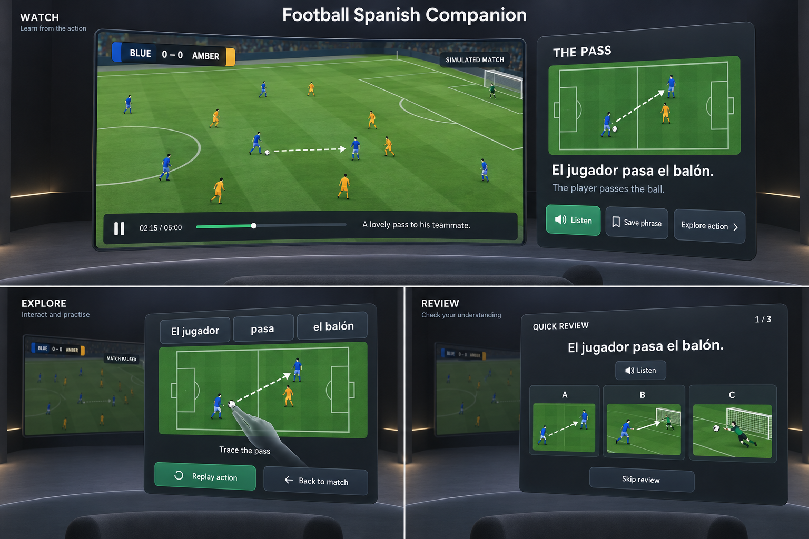

# ArenaVoca PRD

Version 4 · Consolidated project handoff · 12 October 2026

## Project Handoff And Current State

This PRD contains the complete product requirements, technical specification, implementation preferences, build checklist, future roadmap, research context, and visual design brief. It is the primary planning reference for the new project. Separate specification, checklist, build notes, or prompt files are not needed to understand the plan.

The user will create the Codex project. Place this file in its root as PRD.md. Keep football-spanish-visual-prototype-v1.png beside it to display the reference image. The full design brief and generation prompt are included below, so the text remains usable even when the image is unavailable.

### Confirmed Working Context

- The user owns a Meta Quest 3, is working alone almost full time, and has no stated Unity or web development background.
- The user selected TypeScript + Meta IWSDK + Three.js and will rely heavily on Codex for implementation.
- Codex should build with the user as a learning partner: explain one relevant VR concept before a meaningful change, connect it to the actual implementation, and offer a small hands-on experiment on Quest 3. Continue routine implementation autonomously, provide concise progress updates, and use major milestones for device testing and reflection.
- The selected standout moment is tracing a pass while the Spanish phrase unfolds.
- English commentary and Spanish pronunciation will be AI-generated, prepared in advance, and reviewed before release. The authoring provider and final voices are still to be selected.
- Human Spanish coaching is a future feature, not a dependency of the individual MVP.

### Learning And Community Demo · 13 October 2026

The user plans to demonstrate ArenaVoca at [DevDay Exchange Community: Brussels](https://luma.com/my26sz4n) and wants to share their learning process as someone new to VR development. The event includes community discussion, Q&A and demos; an individual presentation length has not been confirmed.

Proposed narrative: **Building a place to learn Spanish—and learning VR along the way.** Show the user's decisions, experiments and discoveries alongside the prototype. Do not imply that implementation by Codex establishes the user's understanding; use hands-on experiments and the user's own explanations as evidence of learning.

Suggested five-minute story, adjustable to the actual slot:

1. Explain the motivation: enjoy a match while learning useful Spanish, with optional practice alongside uninterrupted viewing.
2. Show the turning point: the first browser-window approach did not feel immersive to the user. Their headset feedback led to the theater and passthrough experience.
3. Demonstrate the match, a floating phrase panel, deliberate placement, and passthrough. Explain one discovery: panels positioned in the virtual world stay in place as the viewer turns their head.
4. Describe one technical constraint and the decision it caused: the YouTube iframe could not supply the video texture for the immersive screen, so the prototype uses the user's local recording.
5. Close with what the builder has learned and the next experiment. Include the AI coach only after a successful physical Quest rehearsal; keep a short local recording of the prototype as a presentation fallback.

Working cadence for subsequent features:

- Explain one concept in plain language and identify the relevant feature file.
- Offer one small experiment or decision the user can own, such as changing a panel's position and predicting how it will feel.
- Implement and test the change, explaining the important tradeoff without narrating every code edit.
- Invite a focused Quest observation, then record the assumption, experiment, actual observation, decision and next question in existing implementation notes.
- Continue independent work while awaiting device feedback. Do not record an offered exercise as completed learning or browser checks as physical device acceptance.

First proposed learning exercise: world-space versus head-relative panels, using the existing placement presets to compare comfort and visibility. The prototype supports deliberate placement presets, not free dragging. Explain the coordinate system before inviting changes.

Demo evidence must remain precise: the user has confirmed passthrough with their room and floating screen visible. Physical AI coach acceptance remains pending. Full-match practice is manual; the coach does not hear or understand the broadcast. Spanish audio awaits fluent review, and language-learning effectiveness has not been validated.

### Kotlin Multiplatform Companion And Match Recap · 13 October 2026

The user selected Kotlin Multiplatform (KMP), explicitly including iOS, and proposed language games and quizzes based on the sport watched. The initial native slice shares learning and progress rules across Android and iOS. It lives in `app/native/`, with feature code and tests under `app/src/features/recap/native/`. Existing TypeScript/WebXR viewing remains the playable immersive prototype for the event.

The recap loop is: name a match/race → manually save relevant phrases → select an illustrated sporting action for a Spanish phrase → explicitly check the answer → receive an explanation → review the score → retry missed phrases. A text-answer option remains available. Football and F1 vocabulary stay separate. No timer, lost lives, inferred fluency, live match recognition or automatic broadcast transcription. Example sessions are explicitly labelled and must not be presented as actual viewing history. Language content awaits fluent review.

The native companion has platform-native mobile views (Jetpack Compose on Android, SwiftUI on iOS), shared Kotlin rules and versioned local progress. Saved phrases can be exported from the viewing app's browser phrase library as a small recap file and imported using the phone's file picker. The user moves the file between devices; this is not account synchronization. Closing an unfinished recap abandons that attempt without recording a result; saved phrases and completed results persist locally. Mobile review does not control the match.

Confirmed platform decision: retain IWSDK/WebXR for the immersive experience and KMP for the iOS/Android companion. No Meta Spatial SDK migration is planned. Keep shared Kotlin learning rules independent of headset APIs. The web app and Kotlin companion exchange versioned data; they do not currently share executable quiz code. Quest 3 remains the primary device and hackathon target. Vision Pro and Steam Frame require separate browser, input, media and feature checks; WebXR support does not guarantee equivalent passthrough or room understanding. KMP iOS compilation does not establish native visionOS compatibility.

Hackathon focus: retain a complete, hands-first immersive viewing/learning loop; mobile extends the experience and must not be required to finish the headset demo. On 13 October, after the Devpost connector failed, the user explicitly authorized reading the official rules in the browser. Section 4 provides an IWSDK/WebXR hosted-link route and an APK route for Unity, Unreal, Godot, Native/Android or another engine; it does not mandate Meta Spatial SDK. This technology check does not confirm personal eligibility or record agreement to the rules.

Recap transfer v1 includes a source identity, title, sport, saved phrase IDs and explicit sample status. It contains no video, file paths, account credentials or playback commands. Imports validate the complete document before mutation, reject unsupported versions/phrases and mixed-sport selections, and merge repeated imports without losing existing saves or results. The current full-match packs each export their single implemented phrase; the mobile quiz uses that actual count. File export is a browser control after leaving immersive mode, not a spatial download dialog. Leaving XR retains its existing suspension behavior; export itself never pauses, seeks or resumes playback.

Next steps: physical Quest-to-phone file-transfer review; authenticatable account sync; a headset recap surface; then richer exercises such as matching an action to a phrase and rebuilding a sentence. Pronunciation games require a validated assessment method. Do not add unrelated mobile features before confirming the watch-to-practice loop.

Mobbin MCP research is complete: Apple TV sports browsing, Duolingo picture answers and Nibble matching/illustrated learning screens informed the visual exploration. The user selected **Playmaker for mobile** and **Matchday for VR** from generated concepts. Mobile uses warm ivory, cobalt, coral/lavender tonal cards, original sports illustrations, prominent rounded actions and picture-based practice inspired by Material 3 Expressive. VR uses calm dark burgundy surfaces, warm high-contrast text and existing team accents; Matchday changes presentation without moving panels or controlling playback. Android retains Compose Material 3 and iOS retains SwiftUI; this is a shared design direction, not a claim that both use the same UI toolkit.

The first implementation includes illustrated football/F1 example heroes, illustrated saved phrases and three visual answer choices derived from the existing sport vocabulary. Selection requires explicit confirmation; switching to text answers preserves the selection. English descriptions support screen readers. Generated hero and action artwork, with their exact prompts, live under `app/src/features/recap/artwork/`. Six simple action illustrations now share a palette and visual style across sports; both native platforms use the same assets. Collections use an adaptive card grid and compact save controls, with practice above the cards. No mobile pronunciation button, fabricated match history or automatic media analysis is implied by the concept images. Exact motion polish, team selection on mobile and a full navigation redesign remain follow-up work.

### What Exists

- Product requirements, a twelve-milestone checklist, the original design reference, and a runnable first prototype in app/. See README.md for commands and docs/IMPLEMENTATION.md for evidence.
- The prototype image has been visually inspected for copy and layout. It is not an interactive app or headset test result.
- The official IWSDK 1.0.1 starter is implemented with feature-based source folders and tests. An original 30-second Blender passing clip and provisional prepared speech exist. Actual Quest performance and hands-only acceptance have not been measured.
- Prototype implementation and desktop automated checks are complete; device-dependent checklist evidence remains open. There are no learning pilot results. The user will review on Quest 3 in the morning of 12 October 2026.
- Hackathon registration, Start membership, final eligibility, and the guided workflow's rules acknowledgment have not been verified or recorded. The local guided-workflow state file has not been initialized.

### Immersive viewing correction · 12 October 2026

The user rejected browser tabs as the primary VR experience and requested an immersive sports theater with floating language-learning options, then added a passthrough experience. The primary prototype must offer **Theater** (enclosed immersive VR) and **My room** (immersive AR with the real room visible). Both keep sports viewing central, optional Spanish practice beside it and explicit pause controls. The user supplied the full Barça recording locally for native video-texture playback. Keep the original sample and secondary YouTube browser path available. F1 and future sports reuse the viewing/learning loop with their own local footage, vocabulary and diagrams. Full-source practice is manual until authored event timings exist.

Target the upcoming Meta VR glasses with eyes/hands interaction, using Quest 3 for current device reviews. Emulator results do not complete physical passthrough or future-glasses acceptance.

### Immediate Implementation Task

Read this document and any instructions in the new project's actual directory. Inspect that repository and runtime, then execute the First Prototype checklist items. Use app/ inside the new project as the proposed application source directory, adjusting to an existing repository's structure when necessary. Do not keep using the old chat's generated folder after the handoff.

The first milestone is a 30-second original passing clip with a virtual match screen, one phrase card, pass tracing, pronunciation, saving, and correct pause/resume. Prepare a concrete runnable result, then give the user the Quest test instructions and collect device evidence before expanding to the full match. Emulator success alone does not complete the headset checkpoint.

The current scope and first milestone are sufficiently defined to begin. Exact package versions, hosting configuration, asset production details, and tracing tolerance should be resolved during implementation and recorded here. Genuine missing access or failed device behaviour may require focused questions; do not repeat choices already confirmed in this document.

### Reading Map

- Product Summary through Epics And User Stories: audience, learning journey, and testable behaviour.
- Edge Cases, What We Are Building, and Non Goals: scope boundaries.
- Future Human Spanish Coaching: later roadmap.
- Additional Release Requirements and Success Measures And Validation: engineering and learning evidence.
- Technical Specification: stack, architecture, content contracts, file structure, data flow, and verification.
- Build Checklist: execution sequence and three selected Quest review milestones.
- Visual Prototype And Design Brief and Image Generation Prompt: the visual direction and reproducible mockup brief.

## Product Summary

The broader product helps English-speaking sports fans learn useful Spanish phrases through sporting actions they already understand. ArenaVoca is the product name; Football Spanish Companion was the original working name for its first content pack. A virtual viewing screen remains the centre of attention. At selected moments, a sport-specific illustration reconstructs an action and connects it to a Spanish phrase with an English explanation. The viewer chooses whether to listen, explore, or save the phrase.

The first release demonstrates this experience through one original, unbranded, six-minute match simulation and an optional one-minute review. It tests whether contextual learning can improve phrase recall without reducing viewing enjoyment. The user additionally authorized real YouTube source playback with a separate browser-window companion; this is a parallel prototype path alongside the original immersive demo.

The broader product promise is: **Enjoy your sport and leave with Spanish phrases you can remember.** The football pack expresses this as enjoying the match. It does not promise fluency or effortless language acquisition.

### Multi-Sport Direction · 12 October 2026

The user broadened the concept beyond football to other sports, explicitly naming F1. The product should support sport-specific content packs around one shared learning loop: Watch → Explore → Hear → Save → Recall. Each pack supplies original viewing content, authored action timings, language material, and an illustration suited to that sport.

The football sample remains the first Quest 3 verification checkpoint. The original immersive sample remains available alongside the newer browser-window path. The user subsequently authorized an F1 viewing source and overtake practice alongside full football playback. The original six-minute authored pack remains a later milestone.

| Sport | Familiar action | Spatial explanation and interaction |
| --- | --- | --- |
| Football | A pass between teammates | Pitch diagram; trace the ball's route while the phrase unfolds. |
| F1 / motorsport | One driver overtakes another | Track diagram with two car markers; follow the overtaking route while the phrase unfolds. |
| Tennis | A serve or return | Court diagram; follow the ball's path and connect its movement to the phrase. |
| Basketball | A pass or shot | Court diagram; replay the route between players or towards the basket. |

For an F1-style original demonstration, a first learning target could be **El piloto adelanta.** / **The driver overtakes.** Other draft targets could cover braking and entering the pits. The overtake phrase, illustration, tracing and pronunciation are now implemented as manual practice; braking and pit-stop phrases remain proposed. All language assets await fluent review. Use fictional drivers and original racing footage for a prepared prototype, consistent with the existing content-production approach.

The illustration should teach the sporting action through movement rather than reuse a football pitch with different labels. An overtake can use route tracing; a pit-stop explanation may instead show a short sequence of stages. Replay remains a complete alternative to any tracing interaction. Whether each interaction improves understanding and preserves viewing enjoyment must be tested separately.

The shared product should own playback timing, pause/resume, pronunciation, saving, progress, review, and hand-operated navigation. Each sport should own its action vocabulary, diagram geometry, and explanation behavior. When a second pack is implemented, introduce explicit pack/sport identity, scope persisted progress by content pack, and test switching packs without leaking events, phrases, or saved positions. The streaming feature now scopes themes, practice and saved moments by source. The original sample validator still covers only the authored football passing slice.

### Parallel Companion And Team Chants · 12 October 2026

The user clarified that learning should happen alongside an uninterrupted match or race. Opening, replaying, tracing, listening, saving, or closing a companion window must not pause, seek, dim, or automatically resume the sporting event. Pause remains an explicit playback control. Session suspension still pauses media and requires an explicit resume. A selected explanation stays pinned when its original prompt expires; newer prompts cannot replace it or count as seen while it occupies the companion. If the match ends while learning, the explanation stays open until closed.

The floating learning window supports deliberate left/right, near/far, and height presets, stored on the device. It stays in world space rather than following the user's head. Default layout and fingertip reach still require Quest 3 testing; Replay supports diagrams positioned beyond fingertip reach. Free dragging and arbitrary rotation are not implemented in this sample.

Before a match, offer a team preference and a neutral “just watching” option. Team chants are an optional companion: show only the selected team's authored chant, highlight its current word, and put a translation directly underneath. Switching or hiding lyrics must never affect match playback. Real chants should use the chant's original language, with English support for this audience; do not relabel Catalan or other languages as Spanish. Do not require microphone access or record singing.

The prototype demonstrates this with fictional Blue/Amber selection and original draft Spanish text at 21–27 seconds. The interface identifies this as a text-timing illustration with no chant audio. Actual song alignment, supporter audio, fluent translation review, and real-team lyrics are still content work; no live chant recognition is implemented. Future recordings should use reviewed word/line cue times from the chosen recording rather than distributing words evenly as the demo does.

Candidate real-match sources supplied by the user:

- [Barça 5–1 Madrid (2018)](https://www.youtube.com/watch?v=WMjohb2tq7Y), uploader FC Barcelona.
- [F1 2026 Miami GP FULL RACE | Replay HD](https://www.youtube.com/watch?v=1UsQ9eQtRyg), uploader Free F1 Replays. This is a candidate reference, not verified official F1 footage.

YouTube metadata was checked on 12 October 2026. The Barça source is now integrated through YouTube’s public iframe player and was observed playing in the browser with a duration of 99:21. The supplied Miami upload disables embedding. The user approved a different embeddable F1 video; the replacement is [Oracle Red Bull Racing’s Behind the Charge video](https://www.youtube.com/watch?v=i5EnUkFLaWs), duration 8:05, observed playing embedded. It is behind-the-scenes coverage, not a full race. No source video was downloaded. Event/chant timings and Quest playback remain unverified. The browser-window integration is separate from the direct-video Three.js sample.

### Team Identity And Commentary Progression · 12 October 2026

The user requested a visual identity representing the chosen team in both football and F1. The prototype offers FC Barcelona and Real Madrid inspired football palettes, Ferrari and McLaren inspired racing palettes, fictional Blue/Amber demo themes, and a neutral option. These use original colour treatments and typography, not official logos or an endorsement. Football surfaces are softer; F1 controls are sharper with compact technical timing labels. Keep text and controls readable against every palette. Changing sport resets the team to neutral; persist the sport and compatible team preference on the device. Theme choice does not replace the original football viewing content with a real match or race.

The user also clarified the learning progression: start the event in the viewer's native language, then switch commentary to Spanish when they feel ready. Keep the choice explicit and reversible; do not infer readiness from tracing or saving a phrase. Changing commentary must preserve match position and play/pause state, respect mute and pronunciation ducking, and switch the accompanying captions. For the current audience and prototype, the supported native-language track is English. Other native languages require additional prepared audio and reviewed captions. Interface explanations and translations remain English.

The original sample includes an English track in its video and a separate prepared 30-second Spanish commentary track with its cue at 6 seconds. Both use the video as the sole timeline. The Spanish script, voice and captions await fluent human review. Failure of the alternate audio returns to English without blocking the match. This functionality does not imply alternate-language tracks exist for either supplied YouTube source.

### Full Sports Viewing Prototype And Design References · 12 October 2026

The user explicitly requested full YouTube football playback followed by F1, with learning in a floating window. `app/watch.html` embeds the full Barça match and the verified F1 behind-the-scenes video alternative. Opening the companion creates a second same-origin browser window with its own layout; Quest Browser controls its position and size. This path uses ordinary browser windows rather than an immersive WebXR scene. Its real headset behavior must be checked separately.

The game’s YouTube clock remains the sole playback authority. Replay and Trace animate an original practice illustration; Listen plays one prepared Spanish phrase; Save phrase stores it on-device. These actions never pause, seek or resume the game. Saving a moment uses the current source position; jumping back is explicit and available in the game window. A detached companion shares the clock, team preference and save status. Returning it closes that window and restores the inline panel without changing playback. Publisher failure leaves practice usable and provides the source link.

Practice cards are manual concepts rather than reconstructions of the currently visible action. No automatic event detection, real-song lyrics or timing, transcription, dubbing, or alternate commentary for these recordings has been implemented. YouTube audio-language availability depends on the uploader; the original 30-second sample retains its working English/Spanish switch.

Mobbin research suggests combining [Frame.io’s large-player/context-panel composition](https://mobbin.com/screens/39416f38-9246-4a6d-bc30-79874a268b5e), [Speak’s prominent phrase and subordinate translation](https://mobbin.com/screens/cef4ab1d-b8b0-4080-96b3-616f466e86ac), and [theScore’s team selection pattern](https://mobbin.com/screens/77b0fb1d-b4d1-40f3-9e6c-6a9f5f5711c9). The implemented browser layout borrows the composition and hierarchy with original code and assets. Team accents personalize a restrained dark background. A future synchronized lyric panel can follow [Loom’s timed transcript hierarchy](https://mobbin.com/screens/208932bc-b2f9-4671-ac57-67868cf2d47e), with lyrics and translation outside the YouTube player.

### Confirmed Product Decisions

| Decision | Choice |
| --- | --- |
| Broader product direction | Multi-sport Spanish learning through sport-specific content packs; F1 is an explicit example |
| First implemented pack and device checkpoint | Football passing prototype |
| Match viewing | A virtual screen inside the headset |
| Demo content | An original, unbranded match simulation |
| Commentary | English initially, optional Spanish at the same video position |
| Explanations and chant translations | English |
| Team identity | Original football/F1 palettes tied to the chosen team |
| Learning language | Spanish |
| Action visual | An illustrated tactical diagram with animated players and arrows |
| Spanish speech | Plays only when the viewer chooses to hear it |
| Test device | The user's Meta Quest 3 |
| Development stack | TypeScript + Meta IWSDK + Three.js |
| Builder context | Solo, almost full time, relying heavily on Codex |
| Implementation approach | Build with Codex while learning VR through short explanations, hands-on experiments and Quest review; routine implementation proceeds autonomously |
| Standout interaction | Trace a pass while the Spanish phrase unfolds |
| Speech production | AI-generated English commentary and Spanish pronunciation, reviewed before release |

Other behaviours below are proposed requirements for the first release. The complete implementation plan and build checklist are included in this PRD. Final visual assets and the exact working schedule remain to be settled.

## Target User

The broader audience is English-speaking adult sports fans with beginner Spanish knowledge who already understand their chosen sport. The first prototype and pilot focus on football fans familiar with common match actions. They want to learn through something they enjoy and are willing to use a headset for a short viewing session.

Their problem is maintaining a separate study habit. Their existing football knowledge can help them understand a phrase through the action they see, even when the Spanish is unfamiliar. Whether they actually retain the phrases and prefer this viewing experience remains a hypothesis to validate.

The initial audience is narrower than all football fans: it requires interest in Spanish, familiarity with football, and willingness to watch in a headset. A fan with no language-learning interest is unlikely to value the additional content.

## Concept Rationale And Existing Examples

The original aspiration was to enjoy Spanish football, including La Liga matches followed by Barcelona and Real Madrid fans, with native-language commentary and visual Spanish learning alongside the action. The confirmed first release narrows this to English support, Spanish learning, a headset screen, and an original unbranded simulation. Real broadcasts and clubs belong to a later, separately scoped integration.

The football concept was chosen over a supernatural companion-fighting idea because its audience and learning problem were clearer. The earlier concept assessment gave football 7/10 for Potential Impact and 7/10 for Quality of the Idea. These are subjective early judgments, not official event scores or evidence of demand.

| Existing Example | Relevant Overlap | Proposed Difference |
| --- | --- | --- |
| [Lingopie](https://help.lingopie.com/support/solutions/articles/150000076255-what-is-lingopie-and-how-to-learn-with-it-) | Entertainment-based language learning, interactive subtitles, and vocabulary review | Connect specific football actions to a manipulable spatial diagram alongside viewing. |
| [Futbol Lingo](https://apps.apple.com/us/app/futbol-lingo/id1615373603) | Football-specific language for communication | Focus on spectators learning during their viewing routine, rather than primarily players and coaches. |
| [Noun Town](https://noun.town/) | Language learning through VR activities and repetition | Use an existing interest in watching football as the context instead of a separate learning game world. |

The earlier search did not find an exact match for the proposed combination. This is a bounded search finding, not proof of originality or an exhaustive market review. The idea's originality rests on timing, action reconstruction, hand interaction, and recall across viewing sessions rather than the broad notion of learning through entertainment.

The key risks are distraction from the match, passive exposure without recall, a narrow football vocabulary, and the need to justify wearing a headset. The pilot compares the spatial explanation with flat bilingual cards and separately checks ordinary viewing enjoyment. The app should show why exploring an action adds value beyond a subtitle panel.

## Hackathon Context For Submission Planning

The event is the Meta VR Start Developer Competition 2026. These planning facts come from the review on 12 October 2026; re-check the official event pages before submission.

- The reviewed deadline is 18 November 2026 at 12:00 PST, or 21:00 Europe/Brussels. The total advertised prize pool is $1 million. [Overview](https://start-developer-competition-26.devpost.com/)
- Entertainment is the proposed track. New Experience is the proposed division for this newly conceived project, subject to its actual development history. A playable build, public demo video under three minutes, and completed submission form are required. [Requirements](https://start-developer-competition-26.devpost.com/)
- The official equally weighted criteria are Innovation & Creativity, Experience Design, Technical Implementation, and Polish & Presentation. Potential Impact and Quality of the Idea were the user's concept-selection criteria. [Judging](https://start-developer-competition-26.devpost.com/details/judging)
- Fully usable hand interaction is a requirement. Seated use within a two-foot radius, short satisfying sessions, and an entrant-built core experience guide the design. [Overview](https://start-developer-competition-26.devpost.com/)
- Age, jurisdiction, developer access, and Start membership need verification. The rules limit each individual to one submitted entry, personally or as a team representative. [Rules](https://start-developer-competition-26.devpost.com/rules), [FAQs](https://start-developer-competition-26.devpost.com/details/faqs)
- The reviewed rules restrict identifiable people, branding, and third-party rights. The chosen demo therefore uses fictional players, original illustrations, and unbranded content. Spanish teaching has English meanings and entry materials will be English. [Rules](https://start-developer-competition-26.devpost.com/rules)

For an IWSDK/WebXR build, the reviewed submission route is an accessible hosted link. Engine-based APK builds use the Competition release channel. The complete official rules govern eligibility and submission; this PRD is a product plan, not a rules acknowledgment. Nothing has been submitted or published.

## Product Goals

1. Make the match enjoyable without requiring learning interactions.
2. Help the viewer connect six Spanish phrases to recognisable football actions.
3. Make hand interaction with the spatial diagram useful and comfortable while seated.
4. Produce a complete, repeatable experience that judges can try without another device, broadcast subscription, or account.
5. Gather evidence about recall, distraction, and willingness to use the companion again.

The product must distinguish exposure from learning. Seeing or saving a phrase is not evidence that the viewer remembers it.

## Core User Journey

1. **Enter.** The viewer sees the match screen and a short introduction explaining that the app teaches football Spanish. They practise selecting one large control with their hand.
2. **Start watching.** They select Start Match. English commentary accompanies the original match simulation. The learning area sits beside the screen and does not cover the action.
3. **Notice a phrase.** After a selected action, during its scheduled replay or stoppage, a small card shows the Spanish phrase and English meaning. A short tactical animation explains the corresponding play. Spanish audio stays silent.
4. **Choose their level of involvement.** They can ignore the card, hear the phrase, save it, or select Explore Action. Ignoring learning content never blocks the match.
5. **Explore deliberately.** Explore Action leaves match playback unchanged. The illustrated diagram opens in a separate floating companion window. The viewer can replay it and, for the passing example, trace the route to connect the phrase to the movement.
6. **Return to the match.** Closing the companion restores the viewing layout without changing playback position or play/pause state. The viewer can also pause, hide learning prompts, or reposition the learning area.
7. **Review optionally.** At the end, the viewer may answer three short questions based on phrases displayed during the session, inspect their saved phrases, replay the match, or exit.
8. **Return later.** Saved phrases, completed review results, and learning-display preferences remain available on the same device. An interrupted session can resume from its saved position.

The defining moment is a passing play becoming a spatial explanation: the illustrated ball follows an arrow beside the match, the viewer traces that route, and the associated Spanish sentence becomes readable in meaningful chunks. Pronunciation is available through an explicit Listen control.

## Learning Content

The demo contains six learning targets. These examples establish the intended content and need a fluent Spanish speaker's review before release. Final English commentary and examples must match what the simulation actually depicts.

| Action | Spanish Phrase | English Meaning | Diagram Behaviour |
| --- | --- | --- | --- |
| Pass | El jugador pasa el balón. | The player passes the ball. | The ball follows an arrow from one player to another. |
| Shot | El jugador dispara. | The player shoots. | An arrow shows the shot towards the goal. |
| Save | El portero para el balón. | The goalkeeper stops the ball. | The goalkeeper intercepts the ball's route. |
| Foul | El árbitro pita una falta. | The referee calls a foul. | The diagram highlights the incident and the whistle moment. |
| Corner | Es un saque de esquina. | It is a corner kick. | The ball starts at the corner and follows the cross. |
| Goal | El jugador marca un gol. | The player scores a goal. | The ball crosses the goal line and the scorer is highlighted. |

Each phrase has one short AI-generated pronunciation clip, one English meaning, and one matching action explanation. Spanish speech in the product must be reviewed for pronunciation as well as wording. The interface and explanations remain in English.

At least two targets recur in a later, visibly different play to introduce repetition. A repeated phrase does not create a duplicate saved entry. The demo teaches phrases in context; it does not include grammar lessons, free conversation, or pronunciation scoring.

## Epics And User Stories

### Epic 1: Start And Watch A Match

**Story S01 — Enter without setup friction.** As a beginner, I want a brief introduction so that I understand what to watch and how to interact.

Acceptance criteria:

- A first-time viewer can see what the product does before starting the match.
- The introduction explains that Spanish audio is optional and that learning prompts can be hidden.
- The viewer can practise selecting a large sample control and can skip the introduction.
- Start, help, and exit are available using hands; no controller, keyboard, or account is required.
- The product identifies the match as an original simulation, so the viewer does not mistake it for a live broadcast.

**Story S02 — Watch without compulsory study.** As a fan, I want to follow the match so that the learning companion adds to my enjoyment.

Acceptance criteria:

- Start Match begins the simulation with English commentary.
- Play, pause, restart, and exit work through hand interaction.
- A viewer who ignores every learning prompt can finish the match.
- Learning content does not cover the match image and does not start Spanish speech automatically.
- Pausing and resuming keep the match, English commentary, and scheduled learning moments aligned.

### Epic 2: Understand A Phrase Through An Action

**Story S03 — See the right phrase at the right moment.** As a learner, I want the diagram and phrase to refer to the action I just watched so that their meaning is clear.

Acceptance criteria:

- The authored demo includes all six target actions and their matching learning content.
- Each prompt appears in a scheduled replay or stoppage after the corresponding action, rather than during another important play.
- A prompt shows one Spanish sentence, its English meaning, and the corresponding action diagram.
- Only one prompt is visible at a time. It remains for up to eight seconds, ending earlier if active play resumes.
- Missed prompts remain available in a Seen This Session list. They do not accumulate over the screen.
- The matching event and content are prepared in advance; the demo does not claim automatic recognition of live match events.

**Story S04 — Explore an illustrated replay.** As a learner, I want to inspect the play with my hands so that the words connect to a recognisable movement.

Acceptance criteria:

- Selecting Explore Action opens the larger floating diagram without changing match playback or commentary. Explicit Pause and Play remain available.
- The diagram reproduces the relevant action with consistent team colours, player positions, ball movement, and arrows.
- Replay Action restarts the explanation without moving the main match position.
- In the passing example, tracing along the route advances the ball and reveals the sentence in chunks: El jugador / pasa / el balón.
- The route tolerates an imprecise hand path. A Replay Action control offers the complete explanation without tracing.
- Closing the companion changes only the learning layout. A playing match keeps advancing; a manually paused match remains paused. Closing must never seek or resume playback.

**Story S05 — Hear Spanish when requested.** As a viewer, I want control over pronunciation playback so that it does not compete with commentary.

Acceptance criteria:

- Listen plays only the phrase associated with the selected card.
- In Watch mode, Listen temporarily reduces English commentary volume and then restores it. The match continues.
- In Explore mode, Listen also ducks commentary while the match continues; a manually paused match stays paused.
- Repeated Listen selections restart the selected phrase without overlapping voices.
- Stop, closing the card, or exiting stops the Spanish audio and restores the appropriate commentary state.
- The viewer can replay pronunciation from saved phrases after the match.

### Epic 3: Save And Recall Useful Phrases

**Story S06 — Keep phrases for later.** As a learner, I want to save useful phrases so that I can revisit them without replaying the whole match.

Acceptance criteria:

- Save Phrase visibly changes to Saved when the save succeeds.
- Saving the same phrase again does not create a duplicate.
- The saved list shows the Spanish phrase and English meaning and allows pronunciation and action replay.
- The list survives closing and reopening the app on the same device.
- A viewer with no saved phrases sees an explanation and a way to return to the match, rather than a blank panel.
- Saved phrases can be removed. Match participation does not depend on saving anything.

**Story S07 — Check what I remember.** As a learner, I want a short optional review so that I can test the phrases from the match.

Acceptance criteria:

- At the end of the match, Start Review and Skip Review are equally available.
- A review contains three questions drawn only from phrases displayed during that session, whether or not they were saved.
- Each question presents a Spanish phrase with optional pronunciation and three distinct illustrated action choices. It hides the English answer until the viewer responds.
- Each response gives the correct phrase, action, and English meaning with calm feedback.
- The result shows the first-attempt score out of three. A retry is clearly a new attempt.
- The viewer can leave the review at any point; an unfinished review is not recorded as a completed score.
- If fewer than three targets have appeared, review uses the available targets and shows the correct denominator. With none, it offers watching or saved-phrase browsing instead.

### Epic 4: Stay Comfortable And In Control

**Story S08 — Arrange the companion around the match.** As a seated viewer, I want to choose where learning content appears so that it is easy to read without hiding the game.

Acceptance criteria:

- The match screen is central, with the learning area initially to the right.
- The viewer can move the learning area left or right, choose near/far and low/high presets, choose between two readable text sizes, and recenter the whole layout. Text sizing remains later release work.
- Repositioning cannot place an opaque learning panel over the match image.
- All required controls are reachable while seated without standing, turning around, or making large movements.
- Hide Learning removes prompts without interrupting playback. Show Learning restores future prompts without playing audio.
- Text and team identification remain understandable without colour alone; the diagram uses labels or shapes as well.

**Story S09 — Recover when interaction is interrupted.** As a viewer, I want the app to handle lost hand input or an interrupted session so that I can continue comfortably.

Acceptance criteria:

- Briefly losing hand input during ordinary viewing does not interrupt the match.
- Losing hand input during tracing freezes the diagram's progress and shows how to continue; it does not award completion or advance playback.
- Closing or suspending an active session preserves the most recent available match position and saved phrases.
- Returning offers Resume and Restart; Resume does not replay completed prompts as a backlog.
- Media or pronunciation failures produce an understandable message and retry or exit control. Missing pronunciation does not block viewing or review.
- A failed save does not display Saved. The viewer can retry, and any unpersisted change is identified.

**Story S10 — Control stored progress.** As a learner, I want to understand and reset my progress so that I remain in control of my saved learning activity.

Acceptance criteria:

- The first release uses one device-local learner profile with no sign-in.
- Progress includes saved phrases, completed review results, session position, and display preferences.
- Clear Progress explains what will be removed and requires a deliberate confirmation within the product.
- Clearing progress returns the learning experience to its initial state.
- Optional AI voice practice was authorized on 12 October 2026. Microphone access is explicit; speech is processed by ElevenLabs, with audio storage disabled and a one-day transcript retention setting. Formal pronunciation evaluation remains out of scope.

## Edge Cases

| Situation | Required Behaviour |
| --- | --- |
| A shot is immediately followed by a save | Each target uses a separate scheduled replay segment; cards do not compete or stack. |
| The viewer opens an explanation as a prompt expires | The selected explanation remains pinned while the match continues; newer prompts never replace it. |
| The viewer hides prompts after seeing a phrase | Future prompts stop; the previously seen phrase remains in the session list. |
| The viewer seeks or restarts | Seeking is outside the first release. Restart resets the current session's seen list and review but preserves saved phrases and past completed results. |
| The viewer wants review before the match ends | Early review is outside the first release. They can inspect seen and saved phrases alongside the playing match; pausing is optional. |
| The viewer moves the panel or changes text size while exploring | The selected phrase and replay state remain intact. |
| The viewer never chooses Listen | The entire session and review remain usable through text and illustrations. |
| Commentary was already muted before Listen | It remains muted afterwards; audio restoration respects the viewer's setting. |
| The viewer exits before the first learning event | Resume is available, and the product does not imply any phrase has been learned. |

## What We Are Building

Every item in this list is required for the first release unless explicitly described as optional for the viewer.

- One original six-minute match simulation with fictional teams and players, English commentary, six distinct action targets, and at least two repeated targets.
- A match screen, an illustrated action area, and one enlarged exploration view.
- Hand-operated navigation, playback, exploration, listening, and saving.
- An optional route-tracing interaction for the passing example, with replay as an alternative.
- Six reviewed Spanish phrases, English meanings, and pronunciation clips.
- Seen and saved phrase lists, one optional three-question review, and progress on the same device.
- Left or right placement, text sizing, recentering, and prompt hiding.
- A complete demonstration that works with its prepared content and does not depend on a live match or another device.

The match simulation should be a short, watchable sequence of plays with score progression and commentary. It does not need a full football game, realistic player faces, or a stadium crowd simulation. The tactical illustrations use original assets and a coherent visual style.

Protect pass tracing for the first passing example: the user selected it as the standout moment. If available build time requires a reduction, simplify decorative assets, elaborate match rendering, or additional bespoke animations first. Replay Action remains an accessibility and tracking fallback. Changes to the six-phrase scope or an essential tracing limitation must be reflected in this PRD and discussed at the relevant Quest milestone.

## Non Goals

- **Live broadcast ingestion or synchronisation:** broadcast integration and content access introduce dependencies that are unnecessary to test the learning loop.
- **Club logos, identifiable professional players, broadcast footage, and copied commentary:** the viewing content uses fictional identities. User-selected club/team names and original fan-inspired interface colours are supported.
- **Automatic event detection or generated live explanations:** authored events make it possible to verify that every learning moment is correct.
- **Additional native languages beyond English:** the prototype supports English and Spanish commentary; further native-language audio and captions need separate content production and review.
- **Full 3D match reconstruction:** the chosen visual is an illustrated tactical diagram with animated markers and arrows.
- **Social viewing, multiplayer, accounts, subscriptions, and cloud syncing:** a single viewer can complete the experience without them.
- **Formal speech assessment:** requires separate acoustic evaluation and fluent-speaker validation. The authorized AI coach offers bounded phrase explanations and short practice exchanges.
- **Live human coaching:** planned for a later release after the individual learning experience has been validated.
- **Formal proficiency grading or promised fluency:** the available demonstration supports a narrower vocabulary-learning hypothesis.
- **Watching a real TV through passthrough:** the selected viewing arrangement is a screen inside the headset.

## What We Would Add With More Time

Future work should follow evidence that viewers enjoy and remember the first experience.

1. Longer sessions and additional scenarios, with reviews scheduled across days.
   Sport-specific packs can extend this to F1/motorsport, tennis, basketball, and other sports after the first device learning loop is validated. Each pack needs its own authored action explanations and reviewed language content.
2. A larger phrase library that progresses from action descriptions to understanding short Spanish commentary.
3. Adjustable prompt frequency and difficulty based on demonstrated recall and user preferences.
4. Rights-cleared recorded football content, then a separately scoped live-broadcast companion with explicit synchronisation and failure behaviour.
5. Additional commentary and learning languages, each with reviewed content.
6. Connect learners with a human Spanish language coach, using saved phrases and illustrated plays as the starting point for conversation.
7. Shared match viewing and live coaching during stoppages, after the individual experience and coach sessions are useful.

### AI Coach Roadmap · 12 October 2026

The first AI coach is an optional floating panel in Theater and My room, with a desktop equivalent. It uses the selected sport, team, Spanish phrase and translation. The match remains under its existing playback controls. Coach speech and invited microphone windows lower commentary volume temporarily, respecting the current mute preference.

**Implemented for prototype review:** Explain phrase; Say it slowly; Let me try; Simple Spanish; visible response text; explicit voice start; microphone muted between invited speaking windows (maximum 15 seconds); End session and Close; text-only fallback; connection failure recovery; five-minute client/server session limit. The provider ends a session after 60 seconds of silence. Closing, suspension and page exit end the conversation. Replies are session-local in the app; ElevenLabs is configured not to store audio and to retain transcripts for one day. Slow delivery is an AI instruction, pending fluent-speaker and device review. There is no pronunciation score.

**Next, before sharing outside the local demo:**

1. Quest 3 voice acceptance in theater and passthrough: microphone permission, reliable mute/stop, speech echo from the match, English/Spanish recognition, latency, readable replies and hand-ray selection. Test glasses hardware independently when available.
2. Server-issued authenticated session credentials, per-user limits and cost monitoring. The demo agent uses a public ID configured only in ignored `.env.local`; this is not authentication. The provider dashboard rejected localhost allowlist entries during setup. Do not deploy that demo configuration publicly. API keys must remain server-side.
3. Reviewed football and F1 dialogues, AI grounding evaluations, better slow speech, interruption handling, and native-language preferences beyond English. Text-only input should support a comfortable spatial keyboard or dictated input fallback.

**Later product experiments:**

- Timestamp-aligned, rights-cleared transcripts for “What did the commentator say?” and translation of the last sentence. Show the exact source/time and admit when context is missing. The current coach cannot hear or watch the broadcast.
- Voice commands to save the current phrase, move the panel and switch supported learning modes, with explicit confirmation for disruptive playback changes.
- Optional pronunciation feedback validated against human reviewers; no proficiency claims based on speech recognition alone.
- Spaced practice using saved phrases, adjustable coaching frequency, and brief post-match review. Store learning history only with a clear learner choice.
- More sports and languages, shared viewing, and handoff to the human coaching experience below.

Acceptance remains evidence-driven: keep the sports experience enjoyable, verify phrase recall separately, and never use browser emulation as proof of physical headset microphone performance.

### Match-grounded Generative Cards · 13 October 2026

The user clarified that the product goal is to generate learning cards from the actual game watched. The fixed football/F1 vocabulary remains available as examples. The mobile companion now also includes a first AI-prepared batch from the local Barcelona–Madrid recording: six cards and two stories derived from English commentary and inspected frame sequences. This is an offline, selected batch, not unattended full-match or live understanding. Generated cards retain the simple Playmaker illustration style.

The user also proposed football and F1 stories to connect viewing with broader Spanish practice. [Learning Spanish through football and F1](docs/SPANISH_THROUGH_SPORT_RESEARCH.md) reviews relevant research, proposes an optional watch → story → recall → use sequence, provides two original fictional lessons, and specifies three participant-study plans. Stories can reuse match vocabulary between fixtures and introduce sequencing, reasons and everyday language. The first two fictional stories are now implemented in the KMP mobile companion; the participant studies remain proposals, with no measured learning outcomes. Any in-match story remains learner-invoked and must preserve playback and the pinned learning item.

The mobile **Stories between matches** entry follows the selected football/F1 sport and is also available inside its collection. Each story has three ordered illustrated scenes, optional English support, an explicitly checked comprehension choice, a typed missing word with an optional hint, and an open Spanish response followed by a model answer and learner reflection. Recognition, assisted/unassisted recall and personal use remain separate; open answers receive no automatic correctness or proficiency score. Stories are labelled fictional practice, never generated from the recording. This first slice keeps story attempts in memory and explicitly says they are not saved; existing saved phrases and recap results are untouched. Retrying starts a fresh attempt. There is no new headset panel or playback connection. The authored story catalog and shared lesson rules live under `app/src/features/stories/`; both native platforms use the existing original Playmaker art. Spanish wording still awaits fluent review.

Implemented first batch: **A chance over the bar** (recording 10:40–10:55) and **The run, the pass, the goal** (13:28–13:42). The analysis covers commentary from 03:07–16:40 of the local 99-minute recording. Whisper small runs locally; Codex inspects sequential frames and authors the Spanish adaptation. The source SHA-256, recording ranges, displayed match clocks, commentary ranges/summaries, visual observations, frame positions and review status are bundled with the content. Full transcripts, source audio and extracted broadcast frames stay local and ignored by Git. Six new original illustrations are included, clearly separate from evidence.

The mobile home offers **Explore match moments** for football. The user explicitly reveals the selected passages before seeing their outcomes; no watch progress is inferred. Cards expose **Why this card?** and each real-match story carries its source/evidence through the existing recognise → recall → use loop. This prepared pack does not alter playback, the fixed-ID recap import contract or saved-phrase storage. Spanish awaits fluent review. Story attempts remain temporary; generated-card saving, automatic synchronization and a spatial story surface remain follow-up work.

Recommended first experiment: prepare 5–10 reviewed cards from a short portion of one recorded match. Use existing speech and vision models; do not start by training a foundation model. Transcribe commentary with media-relative timestamps, propose events from the transcript, and inspect a short sequence of nearby frames plus available match metadata to resolve ambiguous actions. Commentary can refer to earlier action or a replay. A single still cannot reliably establish a pass, overtake or braking event. Skip uncertain events rather than inventing identities or outcomes.

Each candidate card needs a source recording ID, media time range, supporting transcript/frame references, event description, Spanish phrase, native-language translation, learner level, illustration description and review status. Validate both structure and factual/linguistic content before publication. The image illustrates the verified event; it is not evidence that the event occurred. Keep match-clock time distinct from recording position and suppress spoilers beyond the viewer's position.

Generate artwork in the background with a shared style brief and reference assets; cache approved cards. AI delays and failures must never pause or seek playback. The selected card remains pinned as the video advances. Keep provider calls and credentials in a backend; mobile and XR consume a versioned card contract, with their existing local examples as a fallback. The current fixed-ID recap-transfer format will need an explicit versioned extension for generated content.

Evaluate event correctness, timestamp alignment, Spanish quality, visual clarity, latency and cost on reviewed football and F1 examples. Consider task-specific fine-tuning only after repeated measurable errors remain despite improved context and prompts, and a suitably licensed annotated dataset exists. Near-live generation and custom action detection are later experiments, not implemented features or hackathon-demo claims.

### Future Human Spanish Coaching

As a football fan learning Spanish, I want to connect online with a human Spanish language coach who can use the plays and phrases I saved so that I can practise speaking about something I care about.

The proposed first coaching experience is an optional session after the match. The learner chooses which saved phrases and diagrams to share. The coach can join from an ordinary browser, see the same illustrated actions, invite the learner to describe them in Spanish, and offer pronunciation and wording feedback. The learner can stay in VR. The session ends with a short list of phrases to practise next.

Future acceptance criteria:

- The learner can tell that they are connecting with a human coach and can see the coach's teaching language and availability before starting.
- Shared learning context includes only the phrases and illustrated actions the learner selects; sharing is not automatic.
- The coach and learner can view the same selected diagram and hear one another. A coach does not need a headset.
- The learner can mute, leave, or end the session and return to their saved phrases.
- If no coach is available or a connection drops, solo learning remains available with a clear retry or return option.
- Personal feedback can be saved with the learner's selected phrases when the learner chooses to keep it.

Coaching is intended to extend recognition into speaking practice. Its learning benefit needs testing separately. Coach discovery, booking, any payments, session recording policy, and shared live-broadcast access require a later scope decision. The first coaching version can operate entirely with the original illustrated action library.

## Technology Direction

The selected stack is **TypeScript + Meta Immersive Web SDK + Three.js**. The experience will run as a WebXR app in the Quest 3 browser and be shared through an HTTPS URL. IWSDK supplies the XR input and spatial interface foundation; Three.js supplies the scene and match-screen graphics; TypeScript expresses the learning, playback, and progress behaviour. Meta documents these capabilities in the [IWSDK overview](https://developers.meta.com/vr/documentation/iwsdk/guides/overview/).

The proposed first release uses a prepared video of the original match simulation, displayed inside the headset, with matching authored event data. It does not calculate a full football game during viewing. Audio and match events are prepared assets; generating content during a session is unnecessary to the chosen learning loop.

Unity with Meta Interaction SDK was the main alternative. The browser stack was selected because the user is relying on Codex, the experience focuses on media and illustrated spatial interactions, and a hosted link gives a straightforward test and distribution path. Its suitability still needs verification on the actual Quest 3 before substantial content production.

## Additional Release Requirements

These requirements turn the proposed stack into a verifiable product. The numeric targets below are engineering goals, not measurements already achieved.

| ID | Requirement | Acceptance Evidence |
| --- | --- | --- |
| R01 | One match timeline governs video, English commentary, captions, and learning prompts. | Pause, explore, restart, and resume produce no duplicated prompts; opening and closing exploration never seek or change play/pause state. |
| R02 | The essential experience works with hand pointing and pinch selection. | Start, navigation, playback, listening, saving, review, and exit are completed without a controller on Quest 3. Trace has an alternative Replay control. |
| R03 | The environment stays stationary, with world-space panels and deliberate recentering. | Seated testers can read and operate the interface without large movements or continuously holding their arms up. |
| R04 | Text remains readable on the actual headset. | English and Spanish accents render correctly; at least three testers can read the six target phrases in the normal layout. Large text does not clip controls. |
| R05 | English commentary has optional captions, and the app works muted. | Captions follow the same timeline. A viewer can finish viewing and review with all audio muted. Spanish pronunciation remains on demand. |
| R06 | The XR scene stays responsive while the video and diagram run together. | A ten-minute Quest 3 run reports frame-rate measurements. Aim to match the negotiated session refresh rate, such as 72 fps, and avoid sustained rendering below 60 fps. Video frame rate is measured separately. |
| R07 | Loading is explicit, and a started session has all required content available. | Start is enabled after required assets load; failed loading offers Retry. A loaded session completes after the network is disconnected. |
| R08 | Loading and content size are bounded. | Aim for at most 60 MB of initial assets and readiness within 20 seconds from a warm cache on Quest 3. First-download duration is reported with connection conditions. |
| R09 | Removing the headset or leaving XR pauses the session. | Returning offers Resume or Restart and does not skip match events. Ordinary brief hand-tracking loss does not pause Watch mode. |
| R10 | Progress survives a normal browser restart at the same app origin. | Saves and results reappear; storage failures are visible. Clearing browser data can remove progress and is not presented as cloud-backed storage. |
| R11 | Reviewed content and original assets remain traceable to their source. | Every phrase, recording, match clip, caption, and illustration has a review or provenance entry before release. |
| R12 | The release can be tested from its hosted build. | A clean Quest browser session opens the URL and completes the core flow without developer tools, account setup inside the app, or a second device. |

For R06, Meta's current [performance requirement](https://developers.meta.com/vr/resources/vrc-quest-performance-1/) distinguishes rendering rate from device refresh rate. The engineering target does not imply that every browser session exposes the same refresh rate.

R07 covers a session after successful loading. Offline reopening after closing the browser is a later caching feature, not a promise of the first release. R11 covers the original demo content; it does not establish permission to use professional football broadcasts.

### First Technology Check

Before producing the six-minute match, verify a 30-second original clip, one Spanish phrase, one illustrated pass, Listen, Save, and Explore on the user's Quest 3. This check must establish that hand selection, video playback, text, audio, and pause recovery work together. Desktop emulation helps development but does not replace this device check.

If this check fails, address the measured limitation before adding content. Remove optional polish or simplify media first. Reconsider the stack only if the essential device flow cannot be made reliable.

## Success Measures And Validation

These are proposed pilot decision thresholds, not measured results or promises of learning effectiveness.

### Product Acceptance

- A tester can complete the full journey seated and using only hands.
- Each of the six targets refers to the correct visible action.
- No Spanish speech plays without an explicit Listen action.
- Ignoring learning content never blocks viewing.
- Explore and closing leave playback uninterrupted or respect a deliberate pause; saved phrases survive reopening.
- A complete match and optional review fit within ten minutes, excluding time the viewer voluntarily spends exploring.

### Learning And Enjoyment Pilot

Recruit eight English-speaking adult football fans with beginner Spanish. Check prior knowledge of the six target phrases before exposure. Counterbalance which of two comparable three-phrase sets appears with the spatial companion and which appears with ordinary flat bilingual cards. Give both conditions the same phrase repetition, translations, pronunciation options, and comparable match actions and exposure duration. The flat-card comparator is a research condition, not an additional release mode. Use different examples for the later action-matching check rather than the exact demonstration images.

Measure unaided task completion, first-attempt phrase-to-action matching immediately afterwards and about 24 hours later, enjoyment on a five-point scale, missed key match actions, and whether participants would choose to use the companion again. Include a short ordinary-viewing segment without learning prompts to establish an enjoyment baseline. Obtain recall answers before revealing translations or replaying examples. Analyse new phrases separately from phrases already known at baseline, and record participant exposure and chosen listening behaviour.

Proceed to a larger trial if at least six of eight participants finish the core flow without assistance, companion-supported phrases show a directional advantage in delayed matching over flat cards, and viewing enjoyment does not decline compared with ordinary viewing. Aim for at least six participants to choose another session. With this small pilot, report individual results and counts; do not claim general learning efficacy or statistical significance.

Use observed distraction to adjust prompt timing and density before expanding the phrase library. If users enjoy the interaction but do not retain phrases, improve repetition and review. If recall improves but enjoyment declines, reduce interruptions before adding content.

## Submission Proof Points

The demo should show actual product behaviour through one clear sequence:

1. Enter and start the match with hands while seated.
2. Show a passing action becoming its illustrated replay and Spanish phrase.
3. Explore the diagram, trace or replay the pass, request pronunciation, and save the phrase.
4. Return to the match from the same position.
5. Answer a review question and show the correct action and phrase.

The write-up should explain the specific audience, the learning hypothesis, and why spatial action exploration adds value beyond a subtitle panel. It should state that the demonstration uses a simulation and prepared event timings. Any retention or enjoyment claim must be supported by actual pilot results, with the sample size and conditions disclosed.

The event review identified hands-first use, seated comfort, short sessions, and an accessible playable build as important design inputs. The official [overview](https://start-developer-competition-26.devpost.com/), [judging page](https://start-developer-competition-26.devpost.com/details/judging), [rules](https://start-developer-competition-26.devpost.com/rules), and [FAQs](https://start-developer-competition-26.devpost.com/details/faqs) remain the references for submission preparation; this PRD is not an eligibility determination.

## Open Decisions For Technical Planning

The visual prototype, its design brief, and its complete generation prompt are included below. The reference illustrates Watch, Explore, and Review; it is not an implemented interface or evidence of headset performance.

| Decision | Why It Matters |
| --- | --- |
| Exact working schedule | The user is solo and almost full time; milestones still need allocation within that availability. |
| Match simulation visual style and production | Produce an original scripted clip and matching diagram data without building a full football game. |
| Static host and stable app URL | Use HTTPS and retain the same origin for browser-local progress. |
| Spanish language reviewer | Release content needs review of wording, meanings, and pronunciation. |
| Visual tone and final product name | The current name is descriptive; final branding should follow a coherent visual direction. |
| Pilot recruitment | Learning and enjoyment claims depend on a real audience test. |

## Technical Specification

The chosen implementation is a WebXR application using TypeScript, Meta IWSDK, and Three.js. A prepared video of the original match simulation plays on a virtual screen. Its playback position drives English captions and scheduled learning prompts; authored diagrams explain the same actions. The first release keeps progress on the same device and uses no runtime backend or AI service.

Package compatibility, media behaviour, and performance remain to be verified by the first runnable Quest prototype.

### Stack

| Layer | Technology | Purpose |
| --- | --- | --- |
| App logic | TypeScript | Explicit types for match events, phrases, state transitions, and saved progress |
| XR runtime | Meta IWSDK | WebXR sessions, hand input, spatial UI, and development emulation |
| Graphics | Three.js version supplied by IWSDK | Match-screen video texture, illustrated pitch geometry, and world-space scene objects |
| Spatial controls | IWSDK UIKitML and interaction components | Readable controls operated by hand ray and pinch; near interaction only where useful |
| Match playback | HTML video element and Three.js VideoTexture | Prepared MP4 simulation with English commentary; playback time is authoritative |
| Spanish audio | Preloaded audio clips through Web Audio | Controlled pronunciation playback and commentary volume reduction |
| Learning data | Versioned JSON and TypeScript validation | Six reviewed phrases, event timings, diagram paths, and caption cues |
| Progress | Browser localStorage | Small device-local snapshots without accounts or a database |
| Development | IWSDK-generated project and its Vite tooling | Code-driven iteration and desktop preview |
| Verification | Vitest, Playwright, and manual Quest 3 sessions | State and content checks, desktop workflows, and actual XR interaction |
| Hosting | HTTPS static hosting, provisionally GitHub Pages | Distribute the built app and its assets through one stable URL |

IWSDK builds on Three.js and includes hand input and spatial interfaces. Its [spatial UI documentation](https://developers.meta.com/vr/documentation/iwsdk/concepts/spatial-ui/) describes UIKitML assets and the interaction tags needed for panel input. Use the official generator and complete examples rather than combining snippets from different SDK releases.

Exact development versions are recorded in README.md, docs/IMPLEMENTATION.md, and the lockfile. Confirm those versions against the first successful device check. Do not independently upgrade the Three.js dependency supplied by the SDK. Unsupported APIs or version combinations must be resolved against the installed SDK and current examples.

### Architecture

The app has one playback authority, one application state store, and independent views. UI controls issue commands; views display state rather than owning separate timers. No server or runtime AI service is required.

#### XR Shell

Implements PRD Epic 1, Epic 4, R02, R03, and R12.

Create the immersive scene, hand interactions, virtual screen, and side panel. Request hand tracking for the target headset. Provide a browser entry page with loading status and Enter VR; starting an immersive session requires a deliberate user action. If immersive VR or hand input is unavailable, show a clear explanation rather than silently substituting a controller-only experience.

Use world-space placement. Hand ray and pinch make the far match controls reachable while seated. The optional tracing view brings its diagram into comfortable near reach. Default placement and size require headset tuning. No locomotion, room scanning, persistent room anchors, or eye-tracking hardware is required.

#### Match Player And Event Scheduler

Implements PRD S02, S03, S09, and R01.

Load the original match as an MP4 with English commentary. Begin with a tested 720p or 1080p asset at 30 video frames per second; choose the final resolution from text-independent video clarity and Quest performance measurements. The XR scene has its own rendering-rate target.

Use the video element's currentTime as the authoritative match position. Do not advance match events using an independent wall clock. Read active events and captions from their intervals at the current playback position. Pause, buffering, media failure, and suspension naturally stop match progression. Record already-seen events so resume cannot produce a backlog or duplicate prompt.

Events include a separate promptStart and promptEnd interval for the scheduled replay or stoppage. A shot and save have distinct prompt windows. Restart creates a new session while keeping the viewer's saved phrases and prior completed review results.

#### Application State

Implements all PRD epics and R09.

Use these modes: Loading, Onboarding, Watching, Exploring, PhraseLibrary, Reviewing, Completed, Suspended, and Error. Pause is a playback property, not a competing app mode.

Opening Explore or PhraseLibrary pins the selected learning item and leaves playback unchanged. The match timeline continues ticking in both modes. Closing leaves current playback intent and position untouched. Leaving XR or receiving hidden session visibility pauses media and pronunciation and enters Suspended. Returning requires an explicit Resume or Restart action.

Keep phrase visibility, selected phrase, prompt hiding, panel side, text size, commentary mute, current session, and review state in the store. Derived state such as commentary ducking must respect mute settings even if the user changes them during pronunciation.

#### Diagram Renderer And Trace Interaction

Implements PRD S04 and R02.

Draw a flat illustrated pitch in world space with original player markers, ball, arrows, and labels. The selected event supplies normalized positions and keyframes; a local replay clock runs only this explanation independently of the playing or manually paused match.

For the passing example, project the active fingertip onto the diagram plane and compare its position with the path. A deliberate Start Trace control selects the tracing hand; merely resting or moving a hand near the diagram must not advance it. Progress follows a continuous corridor along the route and freezes on tracking loss. Tune tolerance on Quest rather than treating it as an exact-pose challenge. Replay Action remains the complete alternative.

Use one event source for the diagram and simulation authoring so the explanation cannot accidentally show a different play.

#### Audio And Captions

Implements PRD S05 and R05.

Preload six reviewed pronunciation clips. Listen explicitly starts or restarts the selected clip, without overlapping voices. Temporarily reduce the commentary volume in Watch mode, restoring the user's current volume and mute preference when playback ends or stops. Listen ducks commentary in exploration too, without pausing the match. Prepared Listen clips need no microphone permission. The optional voice coach asks for microphone permission only when the learner starts it. The optional Spanish commentary track follows the video clock, replaces rather than overlaps English, and obeys the same mute and ducking settings.

English and Spanish commentary captions use authored timed cues and appear inside the XR scene; ordinary browser DOM overlays are not a substitute for captions visible in VR. Caption timing follows the match player. Release font assets must include Spanish accented characters.

#### Progress Store

Implements PRD S06, S10, and R10.

Save one small versioned snapshot under an app-specific localStorage key. Persist on successful save or removal, completed review, settings changes, pause, and periodically during watching. Save the current session's seen events as well as position, so resume retains review eligibility. Keep only the most recent 20 completed review results; saved phrases remain bounded by the six-target library.

Use try/catch for storage access. A failed write stays visible and must not be represented as durable success. Validate stored snapshots before restoring them. Invalid progress offers a fresh start while content still loads normally. Browser-data clearing, private browsing, or changing the hosting origin can remove or isolate progress. This is not cloud sync.

#### Review Engine

Implements PRD S07.

Choose up to three unique phrases displayed in the current session. Each question has one correct action and two distinct distractors. Use diagram assets that do not reveal the English answer before responding. Keep first-attempt scores separate from retries and omit incomplete attempts from completed history.

With only one or two eligible phrases, ask the corresponding number of questions and display that denominator. Zero eligible phrases leads to watching or library browsing. Persist review results, not an unverified proficiency level.

### Content Contracts

| Record | Required Fields |
| --- | --- |
| Phrase | id, Spanish text, English meaning, pronunciation asset, action type, review status |
| Match event | id, phraseId, actionStart, actionEnd, promptStart, promptEnd, diagramId |
| Diagram | id, player labels and normalized keyframes, ball keyframes, arrows, duration, optional trace route |
| Caption | start, end, English text |
| Progress | schemaVersion, contentVersion, savedPhraseIds, recentReviewResults, preferences, resumableSession |
| Resumable session | sessionId, playbackPosition, seenEventIds, seenPhraseIds, completed flag |

Validate before enabling Start: unique IDs; known phrase and diagram references; ordered times within the clip; non-overlapping prompt intervals; windows no longer than eight seconds; all six learning targets represented; at least two targets repeated; valid asset paths; and positions inside the pitch. Timings and audio must match the finished clip, not just its storyboard.

### File Structure

The user requested feature-based structure and tests for every feature, superseding the earlier flat module proposal.

```text
app/
  src/
    index.ts                         Runtime startup
    assets.ts / components.ts        SDK manifests
    features/
      content/                       Contracts, validation, tests
      playback/                      Video authority, scheduler, tests
      session/                       State, coordinator, browser UI, tests
      learning/                      Illustration and tracing, tests
      audio/                         Pronunciation and ducking, tests
      progress/                      Device-local persistence, tests
      xr/                            Spatial assets, hand/UI bindings, tests
    shared/                          Small cross-feature helpers
  public/
    scenes/main.iwsdk.scene.json
    ui/*.uikitml
    fonts/                           Bundled font and license
    content/match.json
    media/match.mp4
    audio/pass-es.mp3
  content-source/                    Movement data, Blender source, audio provenance
  scripts/                           Reproducible content/UI preparation and rendering
  tests/e2e/                         Production-browser journeys
```

README.md contains reproducible commands. docs/QUEST_REVIEW.md holds the physical-device checkpoint. docs/PERSONAS.md contains the three fictional experience scenarios requested after implementation. The original handoff folder is retained as provenance.

### Data Flow

1. Load and validate versioned content, media, fonts, and pronunciation assets; restore valid progress.
2. A user action starts XR and, separately, the match. The match player's position selects the current prompt and caption.
3. Displaying a prompt adds its event and phrase to the session's seen sets.
4. Explore leaves playback running and pins the corresponding diagram in the companion. Listen plays the chosen audio. Save updates the persisted phrase set and then its visible success state.
5. Back restores playback intent. Ending the match supplies seen phrases to the review engine. A completed review becomes a persisted result.

### Match Content Production

Prepare an original six-minute scripted sequence, not a playable football engine. Use fictional teams, stylized players, and a fixed broadcast-style camera. A simple offline rendering workflow can turn the authored movement data into the clip. A 30-second sample establishes whether that workflow gives a watchable result before extending it.

The same play data feeds the illustrated explanation, with the diagram limited to relevant players and arrows. Add English commentary and caption cues after the action timing is stable. Export a compact MP4, check duration and cue alignment, and review the finished clip. Asset production is a substantive build task, not a free dependency.

### External APIs And Dependencies

- [IWSDK setup](https://developers.meta.com/vr/documentation/iwsdk/guides/01-project-setup/) and [complete examples](https://developers.meta.com/vr/documentation/iwsdk/examples/) provide the current project, input, and asset patterns.
- [Three.js documentation](https://threejs.org/docs/) describes scene objects and video textures.
- [WebXR Hand Input specification](https://immersive-web.github.io/webxr-hand-input/) defines joint data underlying fingertip tracing.
- [Vitest](https://vitest.dev/guide/) and [Playwright](https://playwright.dev/docs/intro) support targeted logic and desktop workflow checks.
- [GitHub Pages](https://docs.github.com/en/pages/getting-started-with-github-pages/what-is-github-pages) is the proposed static host. Set the build base path correctly, including runtime-loaded UI, fonts, and media. Select a stable HTTPS origin before testing persistence.
- [ElevenLabs text to speech](https://elevenlabs.io/docs/overview/capabilities/text-to-speech) is an optional authoring tool for exported commentary and pronunciation. The user selected AI-generated speech; recordings are not the chosen production path. No speech service call or API key belongs in the headset app.

WebXR requires HTTPS and user interaction to enter a session. Fetch required media before allowing Start, using a fully loaded local media source for the current session rather than relying on continued streaming. Initial assets should fit the PRD's proposed 60 MB budget. If a complete preload is impractical on Quest, revise media quality or the loaded-session requirement explicitly rather than silently promising offline playback.

### AI Usage

Codex assists with implementation, content drafts, and verification. The selected AI-generated speech is reviewed and exported before release. No runtime LLM, automatic match interpretation, or generated live explanation is required. The product's novelty comes from the spatial learning interaction, not from adding an AI chat panel.

### Future Human Coach Sessions

The PRD roadmap now includes optional online sessions with a human Spanish language coach. This is a separate future release. The proposed first flow shares selected phrase IDs and diagram IDs after the match; it does not require synchronizing two live broadcasts. The coach can use a normal browser while the learner remains in VR.

Keep phrase and diagram IDs stable so selected learning context can be shared later. Real-time communication, session access, coach availability, and any booking or payment services require a new technical scope. Do not introduce those services into the current single-viewer implementation solely to anticipate this feature.

### Risks And Verification

#### First Device Check

Before full content production, verify a 30-second sample, one illustrated pass, a readable Spanish phrase, Listen, Save, and Explore on Quest 3 through HTTPS. Test pinch selection, entering XR, video decoding, audio permission, fonts, pause recovery, and a normal browser restart. Record exact dependency versions and device/browser versions.

#### Content And State Checks

Automated tests should cover defects that could spoil learning: wrong event-to-phrase pairing; overlapping prompts; duplicate cues after pause or resume; stale seen sets after restart; duplicate saved phrases; storage failure falsely reporting success; and reviews including unseen phrases. Test continued playback, an explicit pause during exploration, pinned content after prompt expiry, full time while learning, and closing without seeking or resuming.

#### Headset Acceptance

Run a ten-minute device session with the match, diagram, audio, and normal interaction. Measure rendering rate and compare with the negotiated session refresh. The PRD aims for session-rate rendering and avoids sustained rates below 60 fps, informed by [Meta's performance requirement](https://developers.meta.com/vr/resources/vrc-quest-performance-1/). A 30 fps video is separate from the XR scene rate.

Check readable text, seated reach, muted completion, hand loss, XR suspension, failed loading, and loaded-session playback after disconnecting the network. Desktop screenshots and emulator success do not establish on-device comfort or performance.

#### Compatibility And Scope Decisions

If hands, video, and spatial UI cannot work together reliably in the first device check, investigate that limitation before adding content. If the frame budget fails, reduce media resolution and scene complexity. If tracing is frustrating, widen tolerance and use the replay alternative. Switch engines only for a demonstrated essential limitation, not an untested concern.

### Demo And Submission Flow

Produce the first device slice, then expand to all six targets, then finish saving and review, and finally complete recovery, captions, and polish. Protect time for device testing and the learning pilot. The sequenced checklist follows in this PRD; assign dates once the exact working schedule is chosen.

The hosted build should open without an app account and supply loading and VR-entry instructions. A clean Quest browser session must complete the flow. Demo footage should show actual headset behaviour and clearly identify the prepared simulation. Publishing, registration, and final submission are separate actions; this specification does not perform them.

## Build Checklist

The first prototype is implemented and desktop-tested. Keep device-dependent acceptance open until the Quest review records evidence. Execute remaining milestones in order and preserve the selected major verification pauses.

### Build Preferences

- **Planning:** Codex sequences the work.
- **Build mode:** Autonomous, as selected by the user.
- **Verification pauses:** Major milestones for Quest 3 testing, rather than every task.
- **Comprehension checks:** Not required; explain consequential decisions in progress updates.
- **Git:** Inspect the repository context first. Use local commits at completed milestones as recovery points; do not push or publish as a side effect.
- **Check-in cadence:** Concise updates on findings, failures, and completed milestones.
- **Design reference:** The generated Watch, Explore, and Review prototype.
- **Standout moment:** Trace the pass as the Spanish phrase unfolds.
- **Speech:** AI-generated English commentary and Spanish pronunciation, reviewed before release. Audio is prepared before viewing, with no runtime speech API.
- **Workspace:** The new Codex project root. Keep this PRD at the root and place proposed application source in app/, adapting to existing repository instructions. The old generated chat directory is provenance, not the implementation destination.
- **Scope:** The six-phrase individual learning experience. Human coaching remains a future release.

The twelve items are delivery milestones. During implementation, split each into short, verifiable work sessions. The complete experience is not a promise of twelve 15-minute tasks: SDK integration, match content, and device testing can each require substantial work. Keep all items unchecked until the stated evidence exists.

### First Prototype

- [x] **1. Establish a reproducible IWSDK project**
  Spec ref: Technical Specification > Stack > XR Shell.
  What to build: Inspect the local repository and runtime, generate a TypeScript IWSDK project in app/, enable the needed hand and spatial UI features, and retain the generated dependency compatibility. Record versions and run instructions.
  Acceptance: A minimal scene opens in desktop emulation and offers immersive entry; the app has no dependency on a controller-only flow.
  Verify: Run the generated development command and production build. Inspect the scene and XR configuration using the installed SDK's documented patterns.

- [ ] **2. Prepare one original passing play and its learning assets**
  Spec ref: Technical Specification > Match Content Production > Content Contracts.
  What to build: Author a 30-second simulated passing clip, one matching illustrated action, English commentary and captions, and pronunciation for El jugador pasa el balón. Keep original source data and record audio review status.
  Acceptance: The visible pass, its diagram, phrase, translation, audio, and cue timing agree. The clip is identified as a simulation.
  Verify: Play the finished clip, listen to both speech assets, and validate the event intervals and asset paths. Mark provisional audio honestly until reviewed.

- [ ] **3. Build the match screen and one synchronized learning card**
  Spec ref: Technical Specification > Match Player And Event Scheduler > XR Shell.
  What to build: Display the prepared video in world space with hand-operated playback controls. Drive one phrase prompt and caption from the video position. Keep the learning card beside the match.
  Acceptance: PRD S02, S03, R01, and R02 work for the sample. Pausing or restarting cannot drift the prompt or duplicate its event.
  Verify: Test play, pause, restart, and ignored prompts in desktop emulation. Add targeted timing checks for duplicate or stale events.

- [ ] **4. Implement the pass tracing moment**
  Spec ref: Technical Specification > Diagram Renderer And Trace Interaction > Application State.
  What to build: Open the separate illustrated pitch while the match keeps playing, deliberately start tracing, and reveal El jugador / pasa / el balón as the ball follows the route. Add Replay Action and Back to Match.
  Acceptance: PRD S04 works; resting hands do not trigger progress, tracking loss freezes tracing, and Back preserves both match position and previous playback intent.
  Verify: Inspect hand-input mapping in emulation, test a previously paused match, and record the tolerance settings for on-device tuning.

- [ ] **5. Complete Listen and Save and verify the first Quest milestone**
  Spec ref: Technical Specification > Audio And Captions > Progress Store > First Device Check.
  What to build: Add pronunciation on demand, commentary volume reduction, one persistent saved phrase, and a documented HTTPS test route for the sample.
  Acceptance: The user completes Start, Watch, Explore, Trace or Replay, Listen, Save, and Back using hands on Quest 3. Spanish speech never starts automatically; reopening preserves the saved phrase.
  Verify: Run the sample on the actual Quest 3. Check text accents, readability, video and audio, seated reach, pause recovery, and a browser restart. Desktop success alone does not complete this item.

**Milestone A — Quest prototype review:** Ask the user to try the completed sample and report readability, selection, tracing, and playback behaviour. Resolve essential failures before full content production. This is the first selected verification pause.

### Complete The Learning Experience

- [ ] **6. Expand to the complete authored match**
  Spec ref: Technical Specification > Match Content Production > Content Contracts.
  What to build: Extend to the six-minute simulation, six target actions, at least two repeated targets, reviewed speech, captions, and corresponding diagrams. Reuse the verified production method.
  Acceptance: PRD Learning Content and S03 hold for every target. Prompt windows occur in separate replay or stoppage intervals and never overlap.
  Verify: Validate the entire content set and inspect each visible play against its learning content. Check exported duration and compressed asset size.

- [ ] **7. Finish the seated viewing interface**
  Spec ref: Technical Specification > XR Shell > Application State.
  What to build: Complete onboarding, help, exit, left/right placement, text sizes, recentering, prompt hiding, mute, and caption controls using the prototype's visual direction.
  Acceptance: PRD S01, S02, S08, R02–R05 work end to end. Learning panels never obscure the match and do not require large physical movements.
  Verify: Inspect all modes in emulation and test controls with hands. A short Quest check establishes that the full layout remains readable and reachable.

- [ ] **8. Complete seen phrases and durable progress**
  Spec ref: Technical Specification > Progress Store > Application State.
  What to build: Add seen and saved phrase lists, deduplication, removal, preferences, resumable sessions, bounded review history, and Clear Progress. Handle invalid or unavailable browser storage.
  Acceptance: PRD S06, S09, S10, R09, and R10 hold. Resume preserves seen events; restart clears only current-session activity; failed writes never claim durable success.
  Verify: Run meaningful persistence and failure tests, restart the browser at the same origin, and inspect Resume, Restart, and Clear Progress behaviours.

- [ ] **9. Add the optional recall activity**
  Spec ref: Technical Specification > Review Engine.
  What to build: Present up to three questions using only phrases displayed in the session, distinct illustrated choices, optional pronunciation, and first-attempt scoring.
  Acceptance: PRD S07 holds, including zero, one, or two eligible phrases, skipped review, unfinished attempts, and retries. No answer is revealed before a response.
  Verify: Test eligibility and scoring logic. Complete a full viewing-to-review journey in desktop preview.

**Milestone B — Complete learning loop:** Show the user Watch, Explore, saved phrases, and Review on Quest 3. Collect feedback on distraction and comfort before final polish. This is the second selected verification pause.

### Release Verification And Handoff

- [ ] **10. Verify loading, recovery, and headset performance**
  Spec ref: Technical Specification > Risks And Verification > External APIs And Dependencies.
  What to build: Complete preload status, Retry, missing-media handling, XR suspension and resume, and efficient resource use. Check deployment base paths for all media, fonts, and UIKitML assets.
  Acceptance: PRD R06–R10 and R12 have recorded evidence, including a ten-minute Quest run and loaded-session playback after network disconnection. Numeric targets are reported as measured results, not assumed passes.
  Verify: Run the production build and targeted tests, record frame-rate and loading observations on Quest 3, and test a clean browser session. Any unresolved requirement remains explicitly open.

- [ ] **11. Review learning content and gather pilot evidence**
  Spec ref: PRD > Learning Content > Success Measures And Validation.
  What to build: Obtain Spanish wording and pronunciation review, conduct the proposed small learning/enjoyment pilot where feasible, and fix material distraction or comprehension problems.
  Acceptance: Release language is reviewed. Any claimed learning or enjoyment result identifies actual participants, conditions, and outcomes; unrun parts remain identified as unrun.
  Verify: Inspect review notes and pilot records, compare delayed recall with the planned flat-card condition, and retest only affected product behaviours after fixes. Do not contact participants or a reviewer without the user's authorization.

- [ ] **12. Prepare Devpost handoff**
  Spec ref: PRD > Submission Proof Points; Technical Specification > Demo And Submission Flow.
  What to build: Assemble the product story, actual gameplay screenshots, accessible-build instructions, source reference, a demo sequence under three minutes, original-asset notes, testing results, and outstanding limitations. Re-check current event requirements during submission preparation.
  Acceptance: The participant has concrete materials for the prepare-submission workflow. Prototype images are distinguished from actual implementation footage, and the prepared simulation is identified.
  Verify: Review the handoff and ensure each claimed feature can be demonstrated. Publication, registration, and submission are carried out only when separately authorized; preparing the handoff does not submit anything.

**Milestone C — Release review:** Give the user the final device-test summary, known limitations, and submission materials. This is the final selected verification pause.

## Visual Prototype And Design Brief



The built-in image generation tool produced this static design reference on 12 October 2026. The user accepted it as the starting visual direction and selected tracing as the standout interaction. The board is a presentation of three separate app states, not a requirement to display all three at once inside the headset.

### Watch

A large match screen is visually dominant, with a smaller learning panel to the right. The screen shows an original stylized blue-versus-amber match, a simulation badge, playback controls, elapsed time, and English commentary captions. The separate panel shows an illustrated pass, the Spanish sentence, English meaning, Listen, Save phrase, and Explore action. It never overlaps the match. Left-side placement is also a product requirement.

### Explore

The original handoff image is historical: its paused/dimmed match does not represent the updated parallel-viewing behavior.

The match stays playing at full brightness while the illustrated pitch opens separately beside it. A fingertip traces the passing route and advances the ball. The phrase unfolds in three chunks: El jugador / pasa / el balón. Replay action is the alternative and closing the companion leaves playback intent unchanged. The conceptual hand in the image is not evidence of implemented tracking.

### Review

The viewer sees the Spanish phrase, optional Listen, and three distinct illustrated actions labelled A, B, and C. English answers and correctness are hidden until a response. Skip review is available. The product requires calm feedback and first-attempt scoring after the viewer answers.

### Visual Direction And Copy

Use a quiet dark virtual viewing environment, restrained charcoal panels, off-white readable text, green pitch accents, blue and amber fictional teams, and generous spacing. Keep pitch explanations flat and illustrative rather than miniature 3D stadiums. Avoid excessive transparency, neon ornament, logos, recognizable professional players, and technical implementation details in the product UI.

The first image uses BLUE 0–0 AMBER, SIMULATED MATCH, THE PASS, El jugador pasa el balón., The player passes the ball., Listen, Save phrase, Explore action, MATCH PAUSED, Trace the pass, Replay action, Back to match, QUICK REVIEW, 1 / 3, and Skip review. Its 02:15 / 06:00 timestamp is demonstration copy; the first runnable sample is only 30 seconds. Future content and elapsed time must reflect the actual clip. Image perspective, panel distance, and text size must be tuned on the headset rather than copied as physical measurements.

## Image Generation Prompt

This is the exact stored prompt for reproducing or revising the visual reference. The requested resolution and composition are prompt instructions, not claims that every requested detail was achieved. A later edit must retain the confirmed product behaviour.

```text
Football Spanish Companion visual prototype
Generated on 12 October 2026 using the built-in image generation tool.
Output: football-spanish-visual-prototype-v1.png

Use case: ui-mockup.
Asset type: one high-resolution landscape visual prototype board for a seated Quest 3 VR football language-learning app.
Primary request: Make a polished, practical product interface mockup showing three consistent first-person headset views of Football Spanish Companion. This is a visual design prototype of a real app flow, not an advertising poster. Use a large full-width WATCH view across the upper 60 percent, and two smaller side-by-side EXPLORE and REVIEW views across the lower 40 percent. Clear gutters and small stage labels outside each view. Keep typography large, crisp and readable. Render as a high-resolution landscape image, ideally 2400 pixels wide or more.

Scene/backdrop: Each view is a calm, spacious dark virtual viewing environment with floating world-space panels, soft ambient light, a very subtle floor horizon, restrained neutral charcoal surfaces, off-white text, green accents drawn from the pitch, and consistent blue and amber fictional team colours. No real room, no passthrough. The UI should look plausibly buildable using Three.js, with simple rounded rectangular panels and illustrated diagram geometry. No ornamental holograms.

WATCH view: A large landscape match screen fills roughly the left two thirds of the view. It shows an original stylized football match simulation with simplified anonymous players on a correctly marked green pitch, two fictional blue and amber teams, and a clear passing action. Do not show a real televised match, club branding, sponsor signage or identifiable footballers. The scoreboard reads exactly "BLUE 0–0 AMBER". A discreet badge reads exactly "SIMULATED MATCH". Below the match is a spacious short playback bar with play/pause icon, time "02:15 / 06:00", and an English commentary caption "A lovely pass to his teammate." The match remains visually dominant. Separate from and beside the match, on its right, is a smaller learning panel with the header "THE PASS". It contains a clean flat illustrated tactical pitch, two blue player markers, one amber opponent, a small ball, and an arrow clearly showing a pass between the blue teammates. Under the diagram, large exact Spanish text "El jugador pasa el balón." Then smaller exact English text "The player passes the ball." Three distinct large buttons read "Listen", "Save phrase", and "Explore action". Include a small speaker icon with Listen, but no waveform or any indication that Spanish audio is automatically playing. The learning panel never overlaps or obscures the match. At the top of the board, a restrained title reads "Football Spanish Companion".

EXPLORE view: Another first-person scene using the same environment and exact same visual design. The match screen remains bright and plays independently beside the learning window with the exact status label "MATCH PLAYING". In the foreground, a comfortably reachable large flat illustrated pitch panel shows the same two blue player markers and pass arrow. One simple semi-transparent hand reaches from the bottom edge and traces along the route with its index fingertip, advancing a small ball. Avoid controller hardware. Above the diagram, the Spanish sentence is split into three readable chunks "El jugador" / "pasa" / "el balón". Below it, two large controls read "Replay action" and "Back to match". Show a small exact instruction "Trace the pass". Keep the illustrated field flat and diagrammatic, not a miniature 3D stadium.

REVIEW view: Same quiet virtual setting and panels. An uncluttered review panel reads "QUICK REVIEW" and "1 / 3". The large question sentence is exactly "El jugador pasa el balón." Below it a small "Listen" control. Three clearly distinct illustrated action choices labelled only "A", "B", and "C": A shows a ball passing between teammates; B shows a shot towards goal; C shows a goalkeeper stopping the ball. Do not print English action labels or reveal the correct answer. An unobtrusive "Skip review" button below. Do not show results or success animation before the user answers.

Style: High-fidelity product design, clean typographic hierarchy, thoughtfully spaced controls, coherent perspective, low visual noise, modest panel depth, natural spatial scale. Avoid cyberpunk, neon purple, excessive glass transparency, glowing illegible tiny lettering, smartphone mockups, flat browser dashboards, headset exterior product shots, brand logos, real clubs and live-match claims. Use exactly the supplied interface copy; Spanish accents must be correct. Do not add technical stack names, explanatory essay text, pricing, marketing claims or invented extra features.
```

## Implementation Update · 12 October 2026

The first 30-second prototype now has Watch, Explore, selected-hand tracing, Replay, on-demand Listen, explicit Stop, Save, library, and pause/resume. Exact versions, source provenance, test evidence, and outstanding requirements are in docs/IMPLEMENTATION.md. Updated automated evidence is maintained in docs/IMPLEMENTATION.md. These establish desktop behavior only.

The sample MP4 is 1280×720 at 30 fps, exactly 30 seconds, and 512,507 bytes. Speech uses ElevenLabs multilingual v2 with George for English and Lucia España for Spanish, exported before viewing. Both are provisional pending human review. There is no runtime speech API or account dependency.

Trace settings are provisional: corridor 0.09 normalized units, maximum forward step 0.16, start radius 0.10, and plane depth ±0.08 metres. Actual hand usability and comfort require Quest tuning. No site was published. The root workspace and feature-based app are the implementation destination.

Milestone A remains the next gate. The user will perform the morning Quest review before the full six-minute content is produced.
