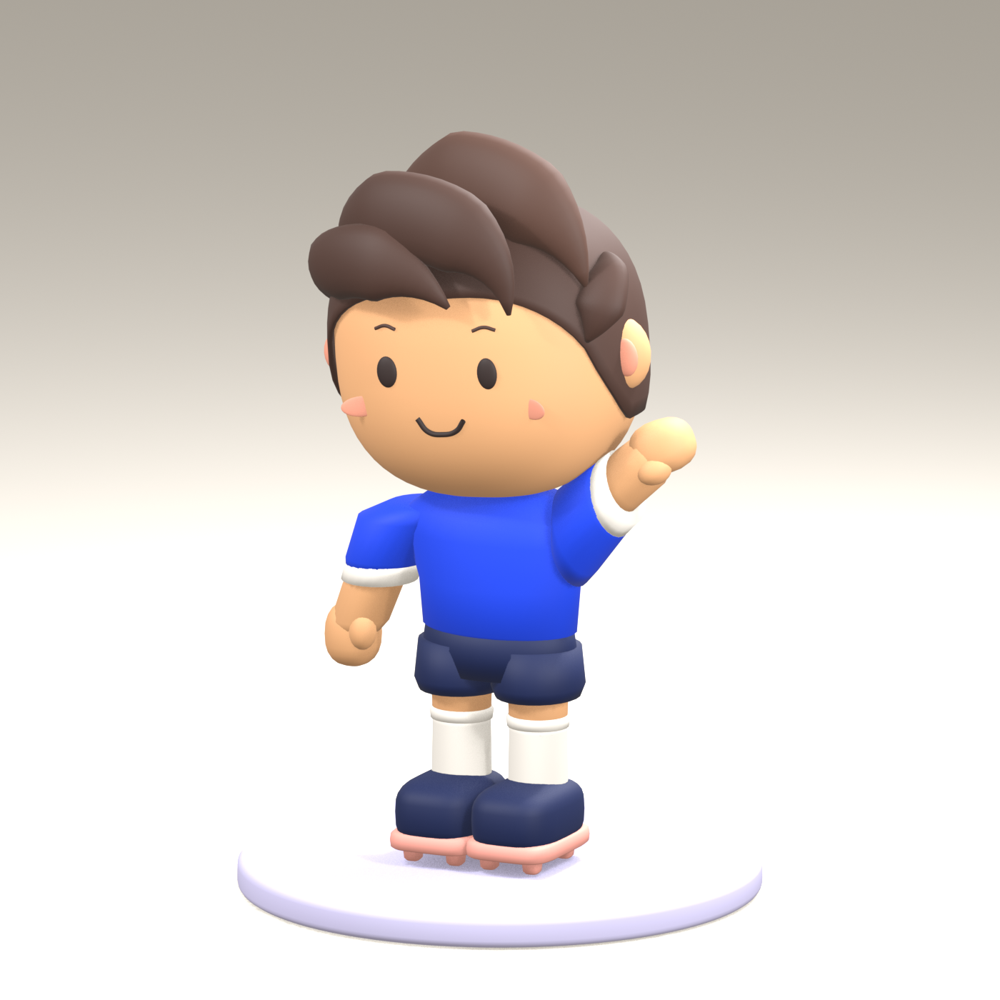

# Kawaii football player — Blender asset v1

Retained as the first pass; see the [refined version 2](../kawaii-player-v2/README.md) for the current asset review candidate.

Created 17 October 2026. This is an original, editable Blender interpretation of the user's approved kawaii concept. The user requested oversized heads, tiny bodies, dot eyes and soft shapes after rejecting the earlier realistic and athletic concepts. The simple lavender field is retained as the visual direction. This asset does not change the active app or restore the deferred tabletop route.



## Files and provenance

- `approved-concept.png`: the user-approved concept, produced with built-in image generation in this chat. It is a design reference, not model or runtime evidence. The image is also packed inside the Blender file.
- `kawaii-player-v1.blend`: original geometry, editable materials, named parts, seven-bone toy rig, three static pose samples, and a separate preview studio.
- `kawaii-player-v1.glb`: the player and toy rig in the neutral Ready pose, excluding studio, reference, cameras, lights and pose animations.
- `build.py` and `forms.py`: reproducible original Blender authoring source. No marketplace meshes, textures, private footage or downloaded character assets are used.
- `model-report.json`: dimensions, axes and authored geometry counts.
- `validation.json`: saved-source and GLB roundtrip checks, when validation has passed.
- `previews/`: front, quarter, back, clay, Hello and delivery renders of the actual model.

The previously selected Blendkit ball is not included. The lavender plinth is preview scenery, not part of the player export. Shirt and cuff materials are independently editable; there are no club logos, sponsors or identifiable-player features.

## Coordinates and editing

Units are metres. The soles are at approximately zero height. Blender uses Z up and -Y forward; the GLB uses Y up and +Z forward. The exported model's measured height and bounds are in `model-report.json`.

Open the Blender file and select `ArenaVoca_Kawaii_Player`. Pose mode exposes Head, Torso, LeftArm, RightArm, LeftLeg and RightLeg beneath Root. The Ready, Hello and Pass actions are single-frame pose samples. The file opens in Hello; the GLB is exported in Ready. These are simple rigid toy pivots, not a finished deformation rig or animated football library. Large shoulder/hip rotations need additional art review before animation work.

The model contains nine colour materials. Broad forms, a rounded head, scalp shell, swept fringe, cheek-mounted features and separate kit/boots are authored directly in Blender. Rear hair and hidden surfaces interpret the illustrated reference; they were not independently approved from a turnaround drawing.

## Reproduce and validate

From the repository root on this Mac:

```sh
/Applications/Blender.app/Contents/MacOS/Blender --background --python app/content-source/kawaii-player-v1/build.py
/Applications/Blender.app/Contents/MacOS/Blender --background --python app/content-source/kawaii-player-v1/validate.py
```

Blender 5.2.2 LTS was used. Building replaces the deliverables in this versioned asset folder. Save hand edits elsewhere before rerunning it. The modelling files use Blender's bundled Python, without extra packages or network access.

## Acceptance boundary

Visual review covers the material and clay views, the face and hair silhouette, footwear and kit separation. Automated validation checks finite geometry, nonzero faces, material/skin data, packed reference, seven bones, exclusion of studio content, and bounds preserved after fresh GLB import.

This is an asset review candidate. It has not replaced `public/models/match-lab/player.glb`, been registered in the IWSDK manifest, or been tested for app interactions, natural hand use or Quest performance. Those are separate integration checks. The exported mesh/material count also needs optimisation review before repeated players are placed in an immersive scene.
