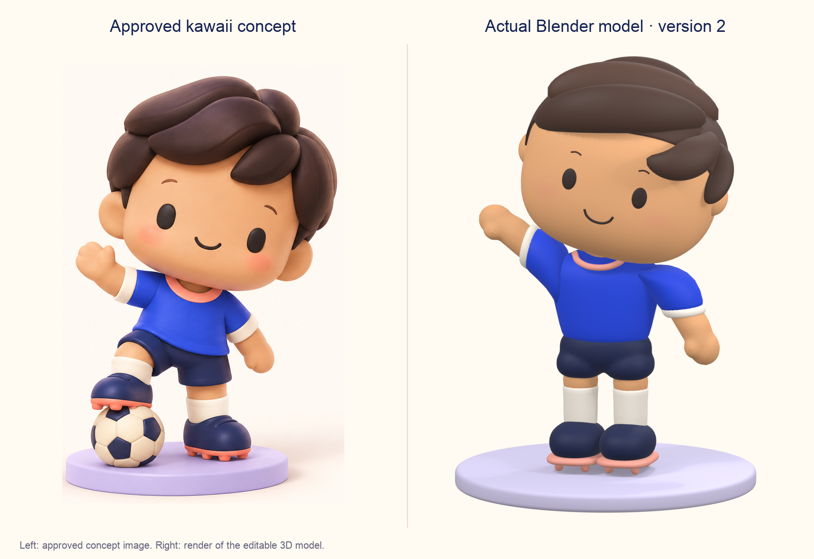

# Kawaii football player — Blender asset v2

Created 17 October 2026 as a refinement of [version 1](../kawaii-player-v1/README.md), following the user's side-by-side critique against the approved kawaii image. This is an original editable model and review candidate, not an in-app replacement.



## Refinement and evidence

The geometry changes are lower, rounded hair locks swept across the head; a wider face with larger dot eyes and a softer smile; vertex-painted blush instead of protruding cheek pieces; rounded shirt/sleeve profiles; a fused shorts volume; continuous arm/palm/thumb forms; and rounder boots. A visible coral crew collar, head tilt and an unobscured waving hand support the toy-like character. A warm ivory backdrop and less intense studio lighting improve comparison with the reference.

The comparison uses an unchanged crop of the original generated concept on the left and a render of the actual Blender model on the right. It is not an image-generation enhancement of the model. The reference includes a ball and a different foot pose; the player export includes neither a ball nor the preview plinth. Hair, proportions and pose remain an interpretation of the concept, and final visual approval is pending.

## Deliverables

- `kawaii-player-v2.blend`: editable geometry, named colour materials, seven-bone toy rig, Ready/Hello/Pass static pose samples, packed concept and separate studio. Opens in Hello.
- `kawaii-player-v2.glb`: player/rig in Ready; excludes reference, studio, cameras, lights and pose animations.
- `build.py`, `forms.py`, `sculpt.py`: original Blender authoring source. No character marketplace assets or private footage are used.
- `approved-concept.png`: user-approved image-generation concept, retained unchanged and packed in the Blender file.
- `previews/`: actual front/quarter/back/clay/Hello renders, delivery hero and concept comparison.
- `compare.py`: deterministic crop/layout of concept and rendered pixels; requires Pillow. No generated-image retouching.
- `model-report.json` and `validation.json`: measured dimensions/geometry and checks performed on saved files.

Units are metres. Blender uses Z up and -Y forward; GLB uses Y up and +Z forward. The neutral asset is approximately 18.6 cm tall, with soles at approximately zero height. The three actions are static rigid toy pose samples, not a finished animation/deformation library.

## Reproduce and validate

From the repository root on this Mac:

```sh
/Applications/Blender.app/Contents/MacOS/Blender --background --python-exit-code 1 --python app/content-source/kawaii-player-v2/build.py
/Applications/Blender.app/Contents/MacOS/Blender --background --python-exit-code 1 --python app/content-source/kawaii-player-v2/validate.py
```

Blender 5.2.2 LTS was used. Building replaces outputs inside this versioned folder; save manual edits elsewhere before rebuilding. Run `compare.py` with a Python installation containing Pillow to reproduce the side-by-side layout after rendering. The Blender model itself needs no external Python packages or network access.

## Verification scope and remaining work

Material and clay views were inspected; the final comparison exposed an occluded waving hand, which was corrected by adjusting the arm and head pose. Saved-source and fresh GLB import checks pass for finite geometry, nonzero faces, packed reference, seven bones, rest bounds, material/skin data and exclusion of studio content. Additional checks prove that there are no raised cheek meshes and that the painted blush survives as GLB vertex colours.

The export contains 59,572 triangles, 40 mesh objects, nine used materials and 1,752,264 bytes. This uses more geometry than v1 to smooth the body and fused forms; optimisation remains necessary before repeated players are integrated. Model approval, IWSDK runtime compatibility, natural hand interaction and physical Quest performance have not been established. The existing app player/field remain unchanged; tabletop remains deferred.
