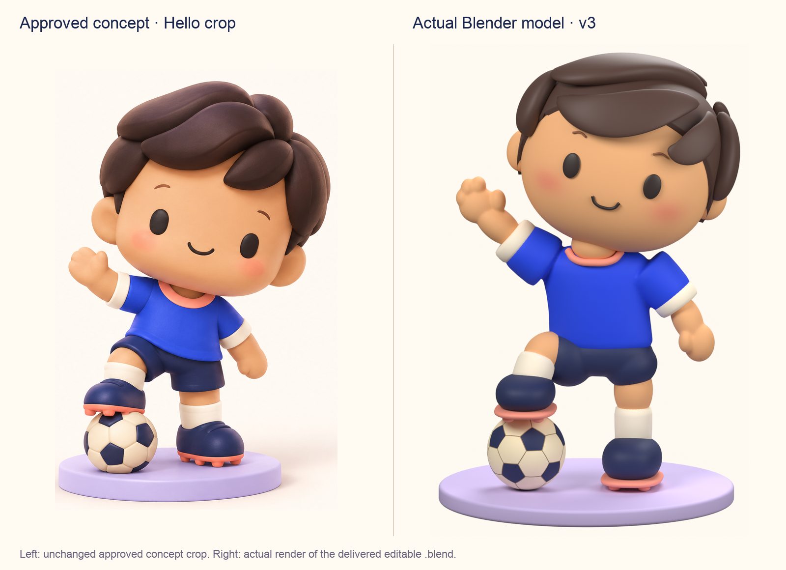
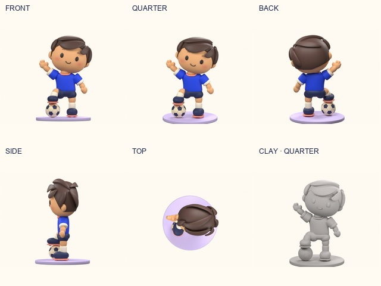

# Kawaii player v3 — Blender reference refinement

18 October 2026. Original editable 3D sculpture made with Blender Python in response to the request for a closer match to the approved kawaii character. This is a separate visual-review candidate; the app player, field and active viewing experience are unchanged. Versions 1 and 2 are preserved.



## What changed

The character now uses the reference's Hello silhouette: a tilted head, raised waving hand and bent leg with the boot resting on an original football. The face is rounder, the peach cheek colour is painted directly onto its vertices, and the eyes and smile sit on the face surface. Shirt and sleeve roots form a continuous rounded sculpt; the raised sock, soft shorts, boot soles and cream cuffs are visible.

Hair is rebuilt as closed rounded swept locks over a fitted scalp. The loops have outward normals, smooth curved terminals and a bounded scalp-relative envelope so the crown and rear locks do not stand away from the head in side/top views. The concept still has more nuanced sculpting and surface texture; this is not a claim of an exact match or user approval. Hidden surfaces are original interpretations informed by the approved image's smaller back view.

## Files

| File | Purpose |
| --- | --- |
| [kawaii-player-v3.blend](kawaii-player-v3.blend) | Editable named meshes, assemblies, materials, vertex colours, packed original reference and presentation studio |
| [kawaii-player-v3.glb](kawaii-player-v3.glb) | Player only, in the fixed Hello pose |
| [football.glb](football.glb) | Separate original football prop |
| [hello-display.glb](hello-display.glb) | Player and football together in their authored contact pose |
| [build.py](build.py), [sculpt.py](sculpt.py), [forms.py](forms.py) | Reproducible Blender source; shared construction helpers retained from the original v2 authoring |
| [validate.py](validate.py), [validation.json](validation.json) | Saved-source and fresh-GLB-import assertions and results |
| [model-report.json](model-report.json) | Exact vertex bounds, mesh/material counts and export contract |
| [approved-concept.png](approved-concept.png) | Byte-identical copy of the user-approved concept from v2 |
| [compare.py](compare.py) | Honest image layouts using the reference crop and actual rendered pixels |

The player has 40 mesh objects, 96,880 triangles and nine material families in the export. The separate football adds 19,808 triangles. These are authoring/review assets; runtime optimisation, draw-call reduction and Quest performance remain unverified.

Units are metres. Blender uses Z up and -Y front; glTF uses Y up and +Z front. The authored standing contact plane is Blender z = -0.0005 m. The origin is at the centre of the scene, 0.5 mm above that plane. The left sole intentionally intersects the football top by 0.5 mm to establish contact. No studio, plinth, lights, camera or reference image is included in the GLBs.

**Pose limitation:** this version uses named editable assemblies and a static authored pose, not the v2 seven-bone toy rig. It contains no skeletal rig or exported animations. Moving an assembly is an editing aid, not proof of production deformation or a finished Pass/Ready animation.

## Evidence and review



- [Hero](previews/hero.png): actual 1100 × 1400 Blender Cycles render from the saved geometry.
- [Front](previews/front.png), [quarter](previews/quarter.png), [back](previews/back.png), [side](previews/side.png), [top](previews/top.png) and [clay](previews/clay.png): actual 640 × 480 camera renders.
- [Concept comparison](previews/concept-vs-model.png): unchanged Hello crop on the left; actual Blender render on the right. Only cropping, resizing, labels and layout are applied.
- [Concept / v2 / v3 comparison](previews/concept-v2-v3.png): historical comparison; lighting and poses differ.

The first material/clay review identified the football core clipping its panels, an obscured raised sock and washed-out colours. Those were corrected. The subsequent side/top review exposed lifted rear/crown hair; a smooth scalp-relative envelope corrected that geometry before the final evidence was captured. Density was reduced from 200,898 to 96,880 player triangles while preserving the silhouette.

`validation.json` records the actual source reopen and three fresh GLB imports. Checks cover finite geometry, nonzero polygon area, materials, painted blush in the export, exact player vertex bounds after reimport, unchanged packed reference, all eight scalp/hair meshes closed with positive signed volume, the ground plane and boot/ball contact. These establish asset integrity, not aesthetic approval.

## Reproduce

From the repository root, using the installed Blender executable:

```sh
/Applications/Blender.app/Contents/MacOS/Blender --background --python-exit-code 1 --python app/content-source/kawaii-player-v3/build.py
/Applications/Blender.app/Contents/MacOS/Blender --background --python-exit-code 1 --python app/content-source/kawaii-player-v3/validate.py
python3 app/content-source/kawaii-player-v3/compare.py
```

The last step requires Pillow. On this workstation it was run with the bundled Codex Python runtime because system Python does not include Pillow. `build.py -- --preview-only` produces compact quarter/clay captures plus the source and exports; omit that flag for the complete evidence set. The tested Blender version is 5.2.2 LTS. All `.blend` geometry is editable; rendering does not depend on external textures or downloaded models.

No image generator was used to portray an improved model. The concept is reference material only. All v3 character, ball and studio geometry was authored with the included Blender source. No third-party character model or texture was imported.

Remaining acceptance: user visual review, any required animation rig/deformation, portable viewer/runtime inspection, optimisation and physical Quest testing. Application/browser suites were not run for this isolated asset-only change.
