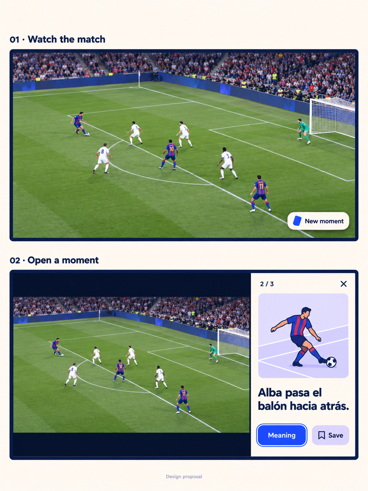
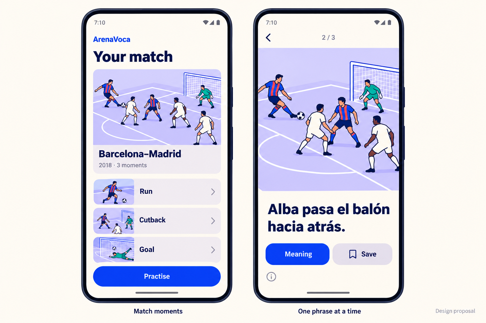
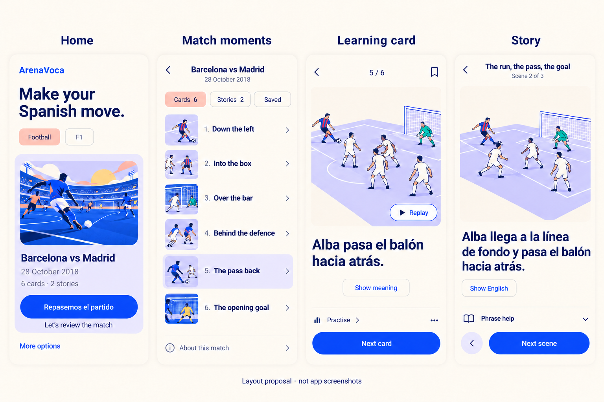

# Match-first TV and mobile proposal

Reviewed: 2026-10-20

Status: implemented on Android. The user retained the original mobile visual identity, then approved a real-event home collection and the four-screen revision below. The generated images below remain design references, not screenshots or usability validation. The user wants the match to occupy more space and essential information to appear only when needed. Character work remains deferred. Requirements remain in the [PRD](../../../PRD.md).

## Proposed experience

Watching fills the TV. A small “New moment” invitation appears after an eligible action and fades without moving focus. Missed moments remain reachable through the remote. No permanent header, card sidebar, moment rail, instructions or implementation notes compete with the footage.

Selecting a moment opens a cream side panel. The match keeps roughly 70–75% of the screen width, remains uncropped and continues playing at the same volume and brightness. This is a starting layout range, not a measured optimum. Preserve video aspect ratio with letterboxing rather than stretching or cropping. The generated board illustrates hierarchy; its pixels are not a layout specification.

The panel contains an illustration, one Spanish phrase, Meaning and Save. Meaning replaces the phrase with its translation; it does not add another paragraph. Back closes the panel and restores focus to full-screen watching. The selected card remains pinned as playback advances. Explicit playback controls remain available on demand and through the remote media keys.

The collection, saved cards, match title, provenance and review status remain available in secondary views. Removing persistent implementation copy must not imply live analysis or automatic cross-device sync. An initial help prompt can explain navigation once; it should not remain under the match.

This earlier two-screen proposal was superseded by the four-screen revision below. The original headline and illustrated identity remain, while the home now uses real event names, dates, counts and bilingual actions. Three illustrated moments for this bounded Alba sequence lead into a single-card view and practice. This does not reduce the existing six-card source pack: the pictured three belong to the TV sequence. The later 21 October refinement removes the Android intermediate confirmation and opens the collection directly; phone/TV watch progress is still not synchronized. The phone collection is independently available; no automatic transfer is implied.

## Mobbin references

Nine screens across three searches were inspected. The most relevant patterns:

| Reference | Pattern to borrow |
| --- | --- |
| [Netflix player](https://mobbin.com/screens/5ceb7a6d-9f9b-4c8c-bb11-4922ae1342c8) | Footage dominates; controls appear when needed. This is a web reference, not proof of TV remote behavior. |
| [Frame.io player](https://mobbin.com/screens/ed2618fe-e7af-48c3-90a3-0a66c30033f2) | Separate optional context from the video. Avoid its professional toolbar density. |
| [CapWords flashcard](https://mobbin.com/screens/5efed624-4c01-41d7-9906-5d12208a48c9) | Large image and one compact learning unit. |
| [Tiimo course cards](https://mobbin.com/screens/1221cdd8-67a0-426d-a974-77d59eb05628) | Illustrated cards, short labels and soft lavender surfaces. |

These inform hierarchy, not a copied interface. Preserve ArenaVoca's cream, navy, blue, lavender and coral, rounded shapes and existing editorial football illustrations.

## Audit and acceptance

The [Impeccable audit](audit.md) separates observed hierarchy problems from native implementation risks. Source inspection, phone/TV emulator captures and the TV font-scale check support it. Generated proposals do not establish runtime behavior.

Acceptance checks, including remaining physical-device work:

- Idle watching has no permanent learning panel or instructional paragraphs; a new moment never steals focus.
- Selecting and closing a card preserves match position, volume, brightness and playback state.
- Every control is remote reachable, focus is visible and Back restores focus predictably.
- Full frames retain their aspect ratio; no text clips at 1.3 font scale. Check 720p and 1080p, then actual Fire TV at viewing distance.
- Spanish and English are disclosed separately; Android opens the collection directly and retains accessible labels.
- Save state is honest about local storage; help/evidence remains reachable.

## Provenance and verification

Images were generated with the built-in image-generation tool using the existing mobile screenshot for style and `match_cutback.png` for illustration direction. [Exact prompts](prompts.md) are retained. Synthetic football imagery is illustrative, not broadcast evidence; original artwork and private recordings were not altered. Final TV proportions and Spanish text were visually inspected. Art still needs human review for whether it clearly depicts a backward pass.

The initial design phase changed no app behavior. The subsequent implementation follows the accepted scope above; current native checks are recorded in [project state](../../project-state.md). Physical Fire TV, TalkBack, couch-distance readability, Spanish quality and user fatigue remain unverified.

## Accepted mobile revision and actual screens

Implemented: latest-first football/F1 collection, real dates, Spanish home actions with English beneath, illustrated Cards/Stories/Saved navigation, one-language card with Replay and persistent Next, and a compact story reader. The six-card football pack is preserved. Marina Bay (11 October 2026) has no prepared race cards yet and links to the user-selected official highlights. LIVE styling and sorting are fixture-tested; no live feed is connected.

The [current native Impeccable audit](mobile-audit.md) records technical issues found after implementation. Actual emulator PNGs and a full-resolution HTML/Markdown gallery are in ignored `app/content-source/match-analysis/mobile-screen-audit/implemented/`; generated references are never substituted for those captures. The gallery covers main routes and learning states, not every Android file-picker/error permutation.

Additional Mobbin references inspected for the accepted layout: [Mindvalley rows](https://mobbin.com/screens/f087abc5-51b3-4264-a88f-dd75ef67c46c), [Babbel illustrated lessons](https://mobbin.com/screens/5fb8e9e7-c029-46c0-a1ab-76a5251bc290), [Speak review](https://mobbin.com/screens/d9b1330c-32aa-430f-abc4-a9a4a8af1e61), [Quizlet cards](https://mobbin.com/screens/80a4c6a5-566b-4005-a227-16ff5eac01e0), and [Headway reading](https://mobbin.com/screens/571fcfe9-a508-44d3-b672-3f9babf8feab). These supplied hierarchy patterns, not copied assets.

The [interactive comic roadmap](interactive-stories-roadmap.md) now links to the bounded native Alba prototype authorized on 21 October. Reusable action templates, configurable kits and engine migration remain future work. That refinement also removes the home More options section in favour of optional pregame vocabulary warm-up.

### Interactive passing warm-up · 21 October

The user selected the combined stadium/mini-pitch design and requested the ball halo and pass highlight from the alternate proposal. [The Android passing prototype](../../../app/src/features/recap/WARMUP.md) implements that first card in Compose: object holds highlight nouns, a flick highlights the verb, and the full lower lavender area supports holding for sentence translation. Next and Skip remain fixed and optional. Cream, blue, navy, lavender and coral are retained. Other Football/F1 cards, TV and the continuous comic are unchanged by this iteration.
