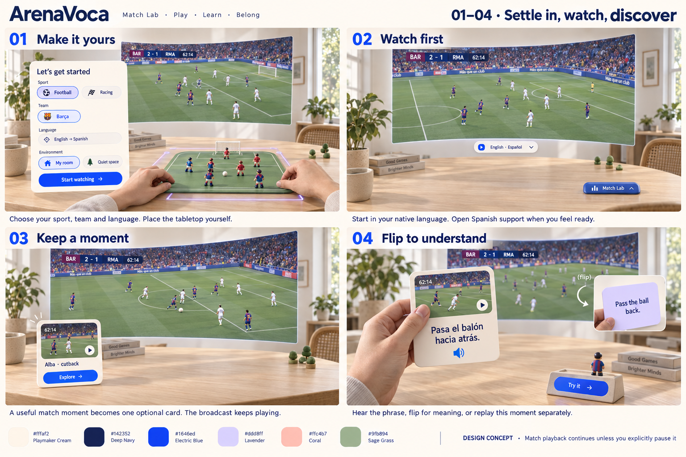
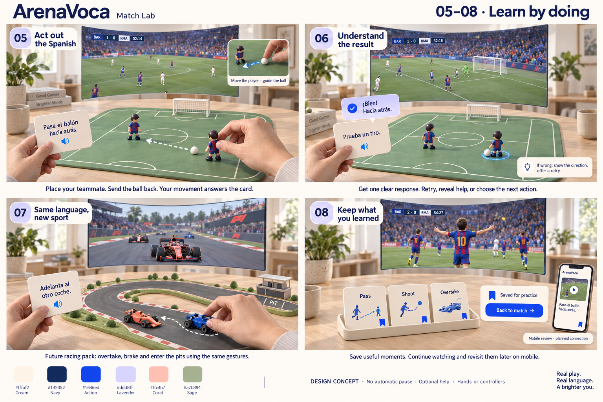

# ArenaVoca XR redesign proposal

16 October 2026 · Approved design direction; first implementation slice authorized and built. Images remain design concepts, not implementation evidence.

This proposal starts again from the user's warm tabletop football/racing reference. It is not an implementation or a replacement PRD. Existing work remains intact. Generated visuals are aspirational, not headset captures or evidence of working interactions. No app behavior was changed for this design.

## Latest decision: hands reveal the tabletop

The user selected this minimal look and retired previous cinema/stadium/banner/decorative-celebration directions. The generated images are retained as style references; **their manual-placement-first setup is superseded by this flow**:

1. Watch the large match screen with an otherwise clear tabletop.
2. Rest both hands deliberately on the table. A faint lavender footprint acknowledges the gesture; after a short stable hold, the pitch and one card appear. The hold duration is a tuning hypothesis, initially 0.6–1 second.
3. Lift a hand: the pitch stays fixed. Grab/flip the card, move a toy, or try optional two-finger football. Keep match playback independent.
4. Close practice deliberately to clear the table. Require hands to leave and re-enter before another reveal. Never hide the board simply because a hand was lifted or tracking briefly failed.

The trigger infers intent from hand poses and available surface information; it is not physical pressure sensing. First-use surface permissions/setup may be needed. With no usable surface information, use explicit hand-height calibration or manual placement; do not present an inferred height as verified table geometry. Use a stable placed board and avoid re-estimating its pose during a kick. Validate accidental activation, different table heights, tracking loss, persistence while lifting hands and full-match performance on Quest.

The user's two-finger photos define an additional input experiment: fingertips act as feet for gentle passes/shots. Keep toy grabbing and target selection as alternatives until the gesture proves reliable. No new interaction has been implemented by this design update.

References: [user-supplied live-build video](https://www.youtube.com/watch?v=D04z9PYUSao) (the precise table-reveal effect is user-reported and was not independently verified from the accessible page); [IWSDK scene understanding](https://developers.meta.com/vr/documentation/iwsdk/guides/11-scene-understanding/) and [WebXR hands](https://developers.meta.com/vr/documentation/web/webxr-hands/) document relevant platform building blocks, not acceptance of this proposed gesture.

## Spatial composition

- Watch zone: a large, gently curved 16:9 screen centered beyond the table. Initial design study: approximately 2.5 m wide at 2.5 m distance, with user-controlled position and size. Confirm comfortable dimensions in Quest before fixing defaults.
- Activity zone: a roughly 60–80 cm wide miniature pitch on a reachable table. Two cute teammates, one ball, one goal. The learning area stays beneath the screen.
- Card zone: one palm-size instruction card beside the pitch, grabbable, flippable and resizable. Extra cards stay in a shallow tray rather than filling the room.
- My room: passthrough with hand-triggered tabletop reveal and manual placement as fallback. Quiet space: a sparse virtual setting with the same table and object positions. No cinema architecture, stadium windows, team banners or decorative celebration systems in this proposal.
- Palette: cream #fffaf2, navy #142352, blue #1646ed, lavender #ddd8ff, coral #ffc4b7. Muted sage is a natural pitch material. Team-specific kits/liveries stay on figures/cars; they do not recolor all learning UI.

## Detailed journey

| Step | What the user does | What responds | Exit / alternative |
| --- | --- | --- | --- |
| 1. Make it yours | Choose sport, team, native language, Spanish support and My room/Quiet space. Rest both hands to reveal the activity surface when ready. | A single setup card, then a clear table; stable hand placement reveals a subtle outline followed by the pitch. Manual adjustment remains available. | Recenter or adjust later. Start watching without opening practice. |
| 2. Watch first | Start the match. Choose when to add Spanish help. | Large screen, small transport control and collapsed Match Lab tab. | Pause only by explicit playback action. Audio language switching is offered only when that source actually has the relevant track; never imply live dubbing exists. |
| 3. Keep a moment | Notice a compact moment card and choose Explore, save it or ignore it. | One card with source thumbnail, real timestamp and concise action label. | Ignoring it leaves viewing untouched. Keep the selected card pinned as the match advances; later items queue without replacing it. |
| 4. Flip to understand | Grab the card, hear its Spanish, physically turn it for translation, or choose its replay. | Spanish front; native-language reverse. Replay shows the card's own excerpt on a separate small surface. | Explicit Flip control and controller selection provide alternatives. Replay is muted by default to avoid competing with commentary; replay audio is a separate choice. |
| 5. Act out the Spanish | Rest both hands to reveal practice, then choose the card action. Place a teammate, then guide the ball toward that teammate. | Tabletop stays placed as the hands lift; task card stays nearby. Clear attack-direction marker establishes what backwards means. Ball follows a short controlled pass rather than teleporting. | Select player/target as an accessibility fallback. Show assistance only when requested or after a miss. No time pressure. |
| 6. Understand the result | Read small feedback, retry, reveal a hint, or choose a shot. | Correct pass: brief receiver highlight and a short phrase. Wrong direction: explain backwards, allow repositioning and retry. | Reset affects exercise only. Distinguish a valid shot from scoring a goal. Keep assisted attempts separate from independent success. |
| 7. Racing branch (future) | Choose racing at setup, then guide a car around another or into the pits. | Same screen/card/board relationship; a miniature circuit replaces the pitch. | This is a separate sport branch, not a mandatory next step after football. Evaluate the route, not just the final position. |
| 8. Keep what you learned | Save the moment, try a short recall prompt without translation, then close practice. | Saved cards settle into a small tray; the tabletop can collapse, leaving the match prominent. | Reopen any saved card. Mobile review uses the same moment/phrase; account sync is a proposed extension, not a demonstrated feature. |

## Interaction targets

- Screen: visible edge grip for moving and corner/two-hand resize; retain a restore-position action.
- Card: pinch its border to move, rotate the wrist to flip, tap the speaker to hear Spanish. The face must not compete with its grab border.
- Player: pinch torso/base, move, release; the selected player gets a subtle halo. Figures remain grounded on the tabletop.
- Ball: try a short guided push/flick as the primary design hypothesis. Tune forgiveness in Quest; no claim of realistic physics. Target selection remains available.
- Tabletop: handle at the near edge for moving; two-hand scaling. Keep objects and card targets readable and within reach.
- Feedback: local, brief and quiet. Optional phrase audio is user-triggered. No automatic dimming, pausing, seeking, or resuming of the main match.
- Tracking loss: suspend the tabletop gesture safely, retain the last valid piece position, and offer recovery without changing playback.
- Uncertain recognition: do not invent an action-specific card. Use a reviewed prepared moment or wait for reliable evidence; label simplified practice separately from broadcast replay.

## Review corrections to the generated drawings

These images communicate layout and tone. They are not an exact interaction specification. The setup illustration contains extra players; the first build should retain only two. The illustrated scoreboards, timings, match images, branded details and Spanish copy are illustrative and must not be used as source evidence. The field must make attack direction explicit before testing a backward pass. Race trajectories in the illustration are schematic. Natural passthrough appearance and hand tracking quality must be assessed on the actual device. Spanish/audio need fluent review.

## Proposed first slice, after design agreement

One room presentation, one large screen, one verified cutback replay card, two teammates, ball, goal, one backward-pass task, optional translation, restrained feedback and return to watching. Establish composition and physical interaction on Quest before adding racing, more actions, atmosphere decorations or mobile sync. Do not implement this proposal automatically.

## Image provenance and generation direction

Created using the built-in image generation tool, with the user's supplied tabletop reference as spatial/style input. Original outputs remain in Codex generated_images; copies here make the proposal portable.

Prompt set: two detailed, high-resolution, four-panel XR storyboards with warm natural home, first-person seated hands, large curved broadcast screen, tangible rounded cards and cute toys, Playmaker UI colors and team-colored figures. Sheet 1 covers setup, unobstructed viewing, optional replay-card discovery and physical translation flip. Sheet 2 covers tabletop action, local feedback, a future racing branch and saved-card/mobile review. Required constraints included uninterrupted main playback, minimal surrounding UI, manual placement, no cinema architecture, no neon holograms and explicit design-concept labels. Specific text and captions in each sheet were supplied to the generator; the generated images can contain illustrative deviations described above.

## First implementation boundary

The recorded-match route now uses the minimal screen, hand/surface reveal, one card and two-player practice. The [feature guide](../../../app/src/features/tabletop-reveal/README.md) distinguishes implemented behavior and verification from proposals. Finger kicking, automatic invitations, saved-card tray, recall UI and the F1 tabletop are not delivered by this slice. Quest acceptance and fluent Spanish review remain open.
