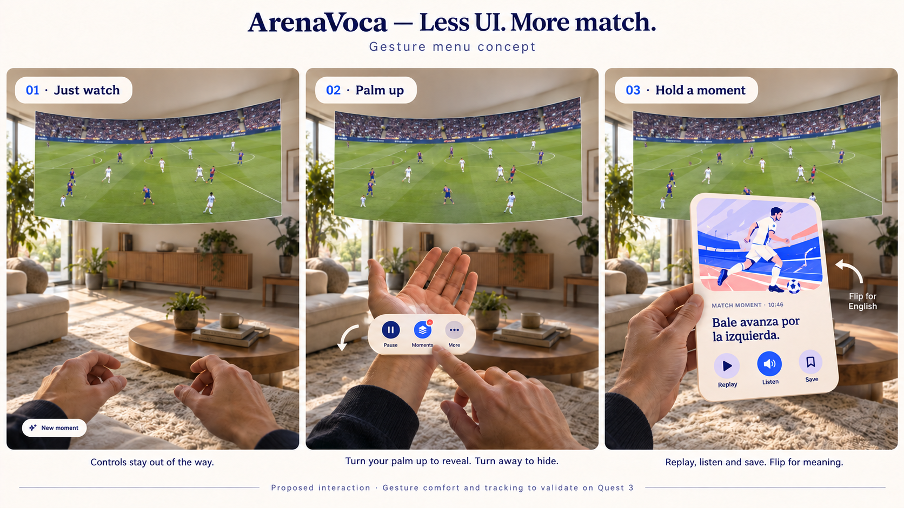

# Wrist menu and moment card proposal

Design exploration, 16 October 2026. The user approved implementation on 16 October after reviewing the image. Virtual cards are the current direction; physical phone and printed-card surfaces remain roadmap experiments. Quest hand-tracking acceptance is pending.

- Turn the palm up to reveal a small Pause/Moments/More menu; turn away to hide it. Validate tracking, accidental activation and controller fallback on Quest before adopting this gesture.
- Preserve the illustrated cream card. Replay, Listen and Save belong directly on its front. Physically turn it over for English and a vocabulary hint; provide an accessible flip fallback.
- Replay runs inside the card, independently of the match. Listen pronounces the Spanish on demand.
- Save moment should retain match/source identity, source time range, card text, translation, artwork, vocabulary and progress for the mobile Saved moments collection. Reference the source clip; do not claim the entire recording has been uploaded.
- A local save and successful cross-device sync are different states. Show Saved on this device, Sync pending, or Synced only when supported by actual persistence/transport results. Existing local save and recap export/import do not establish automatic phone sync.
- Before kick-off cards cover sourced historical team news, lineup highlights and recent matches. Current news must not be mixed into a historical recording, and final results must not leak into pregame notes.

The initial [two-action proposal](concept.png) is preserved for design history. The latest image adds Listen between Replay and Save.

See the [17 October comparison and verification](comparison.md) for rounded silhouettes, cream depth, typography, arrival animation and match mute.
